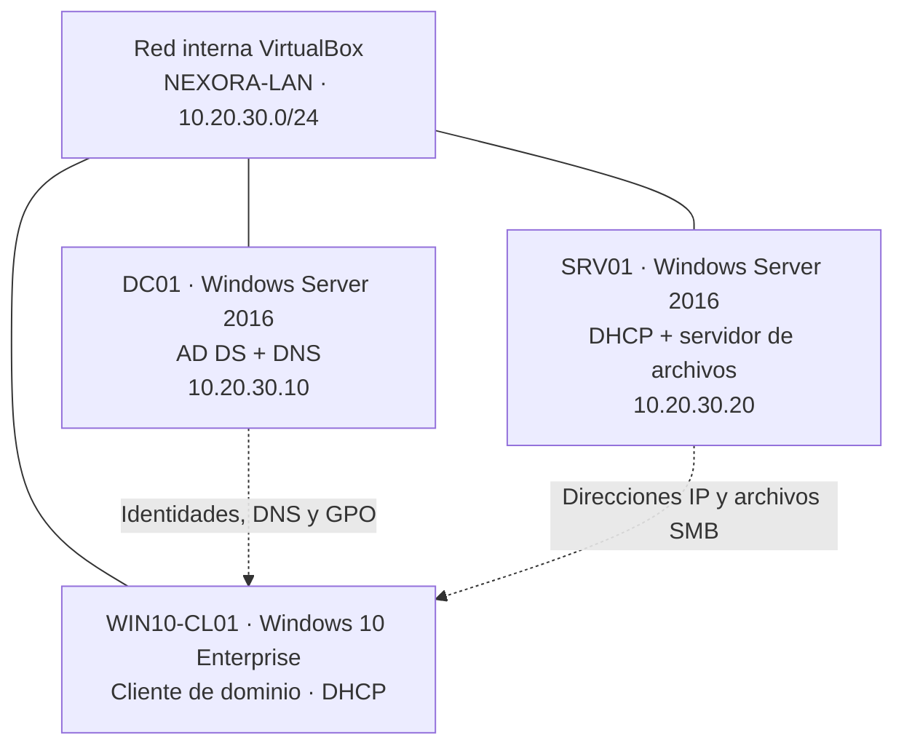
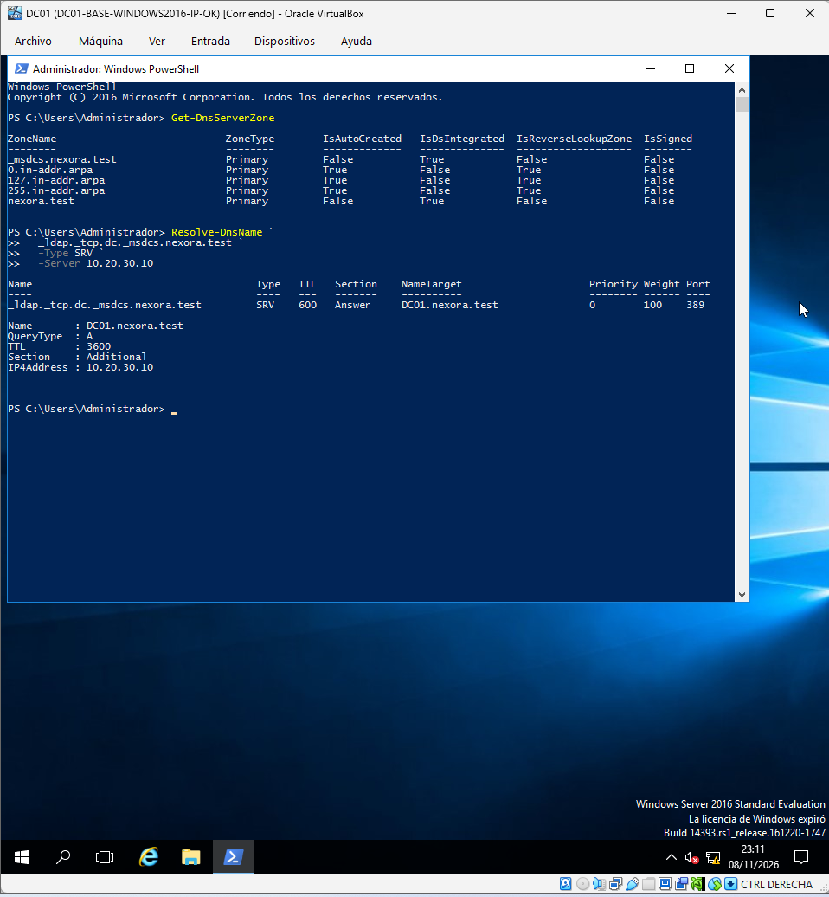
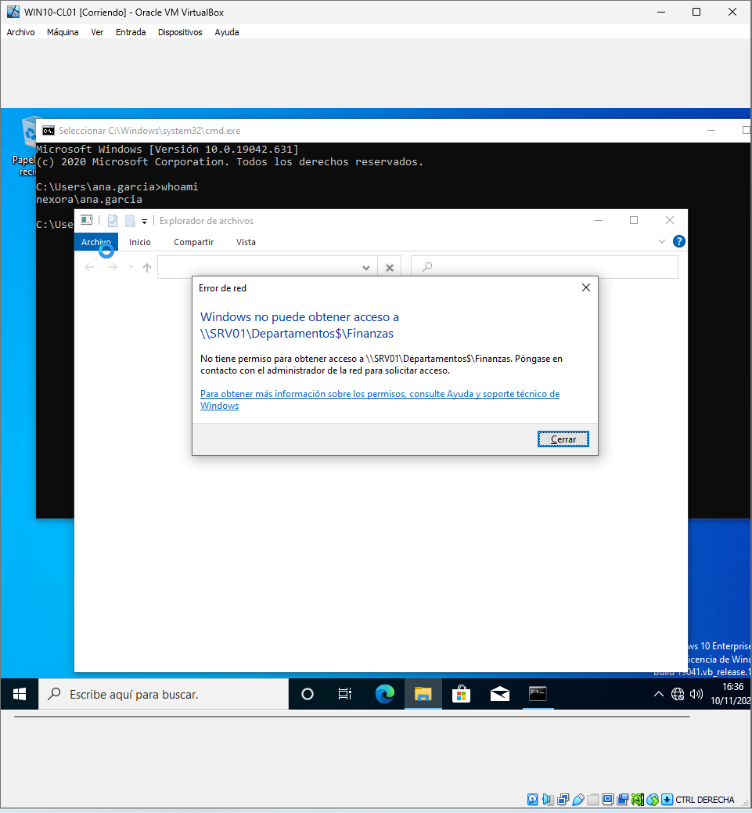
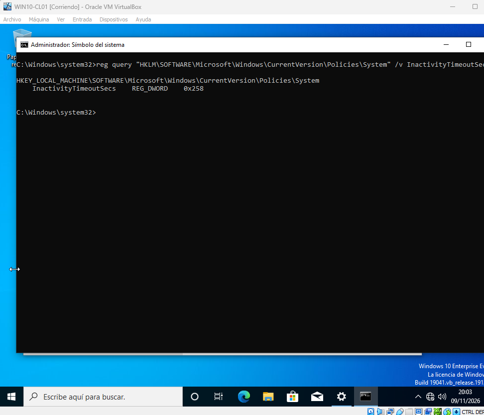

# 🖥️ Windows Server Enterprise Lab

**Diseño y administración de una infraestructura Windows para una empresa ficticia.**

   

**[Explorar las fases](#documentación-paso-a-paso)** · **[Ver arquitectura](#arquitectura-del-laboratorio)** · **[Analizar incidencias](#diagnóstico-y-resolución-de-incidencias)** · **[Consultar scripts](scripts/powershell/README.md)**

> 📌 **Proyecto de portfolio ASIR.** Un laboratorio educativo virtualizado: no una infraestructura real ni una arquitectura recomendada para producción. El proyecto está documentado con capturas verificables y con las limitaciones técnicas señaladas expresamente.

## 🎯 Qué he construido

**Nexora Solutions** es una empresa ficticia de 60 empleados distribuidos entre Dirección, Recursos Humanos, Finanzas, Desarrollo y Soporte IT. He diseñado un laboratorio para reproducir servicios centrales de TI y ejercitar tareas de un administrador de sistemas.

| Área de trabajo | Evidencia del proyecto |
|---|---|
| **Identidad corporativa** | Dominio `nexora.test`, controlador `DC01`, OU, grupos y cuentas |
| **Servicios de red** | DNS integrado en AD DS, DHCP en `SRV01` y cliente Windows 10 |
| **Administración centralizada** | Directivas GPO de equipo y usuario y pruebas con `gpresult` |
| **Control de acceso** | Carpetas compartidas SMB, permisos NTFS y modelo AGDLP |
| **Automatización** | Casos de alta, traslado y baja lógica mediante PowerShell |
| **Diagnóstico** | Incidencias de ICMP, DNS y unión al dominio documentadas |

Las guías muestran qué se configuró, **por qué**, cómo se comprobó y la captura de cada paso. Los scripts publicados son ejemplos didácticos identificados como tales; los originales solo se conservan en las capturas disponibles.

## 🗺️ Arquitectura del laboratorio

| Parámetro | Valor |
|---|---|
| Dominio DNS | `nexora.test` |
| NetBIOS | `NEXORA` |
| Red del laboratorio | `10.20.30.0/24` |
| Tipo de red | Interna, aislada de la LAN física |
| Controladores de dominio | Uno; **sin alta disponibilidad** |

[Ver las decisiones de diseño](docs/01-diseno/README.md) · [Ver el esquema independiente](diagrams/arquitectura.md)

## 📚 Documentación paso a paso

| Fase | Contenido | Guía ilustrada |
|:---:|---|---|
| **01** | Contexto empresarial, requisitos y arquitectura | [Diseño inicial](docs/01-diseno/README.md) |
| **02** | Máquinas virtuales, IP, firewall y conectividad | [Virtualización y red](docs/02-virtualizacion-red/README.md) |
| **03** | Controlador de dominio y registros DNS | [Active Directory y DNS](docs/03-active-directory-dns/README.md) |
| **04** | Estructura de OU, usuarios y grupos de seguridad | [Organización del directorio](docs/04-ou-usuarios-grupos/README.md) |
| **05** | Servidor miembro, autorización y ámbito DHCP | [Servidor y DHCP](docs/05-servidor-miembro-dhcp/README.md) |
| **06** | IP dinámica, unión al dominio y autenticación | [Windows 10 Enterprise](docs/06-cliente-windows10/README.md) |
| **07** | Configuración y verificación de GPO | [Políticas de grupo](docs/07-gpo/README.md) |
| **08** | Grupos AGDLP, permisos NTFS y SMB, pruebas de acceso | [Control de acceso](docs/08-recursos-ntfs-smb/README.md) |
| **09** | Ciclo de vida de usuarios con PowerShell | [Automatización](docs/09-powershell-operaciones/README.md) |
| **10** | Comprobaciones finales de servicios | [Validación técnica](docs/10-validacion/README.md) |

**101 capturas** clasificadas en `screenshots/`: 87 asociadas a las fases y 14 a incidencias. [Inventario y criterios de evidencia](docs/evidencias.md).

### 🔍 Tres pruebas representativas

**DNS integrado en Active Directory:** las zonas `nexora.test` y `_msdcs.nexora.test` aparecen integradas en AD y una consulta SRV identifica `DC01.nexora.test`.

**Control de acceso por departamento:** el laboratorio incluye pruebas de acceso permitido a Desarrollo y denegado a Finanzas desde una cuenta no autorizada.

📷 Ver prueba de acceso denegado

**Políticas corporativas:** se configuró una directiva de bloqueo por inactividad de 600 segundos y se comprobó su efecto en Windows 10.

📷 Ver comprobación de GPO

## 🧰 Diagnóstico y resolución de incidencias

Un administrador no solo instala servicios: también necesita diagnosticar fallos, justificar cambios y comprobar que se recuperó la funcionalidad.

| Incidencia | Síntoma y aprendizaje |
|---|---|
| [001 · ICMP](docs/troubleshooting/001-icmp-firewall.md) | Ping bloqueado; regla específica en firewall sin deshabilitar la protección |
| [002 · DNS](docs/troubleshooting/002-dns-zonas.md) | Ausencia de zonas y error WIN32 123; recuperación desde instantánea y validación posterior |
| [003 · SID/servidor miembro](docs/troubleshooting/003-union-srv01.md) | Error de unión de SRV01; evidencia de recuperación con causa raíz no demostrada |

La promoción inicial usó `ad.nexora.example` y falló la creación de zonas DNS. Se recuperó una instantánea anterior a AD DS y se creó el bosque definitivo `nexora.test`. **La causa exacta del error inicial no pudo acreditarse**, por lo que no se atribuye a un sufijo DNS concreto.

## ⚙️ Automatización y habilidades

El repositorio incluye [ejemplos de alta, cambio de departamento y baja lógica](scripts/powershell/README.md), además de comprobaciones con `Get-ADUser`, `Get-DnsServerZone`, `Test-ComputerSecureChannel`, `gpresult` y herramientas DHCP.

**Competencias demostradas:** virtualización, direccionamiento IPv4, AD DS, DNS, DHCP, GPO, autorización NTFS/SMB, diseño de OU y grupos, PowerShell, pruebas técnicas, recuperación y documentación de incidencias.

## 🔒 Seguridad, contexto y limitaciones

- Entorno educativo aislado mediante VirtualBox, sin servicios publicados en Internet.
- Se utilizan usuarios y departamentos ficticios. No se incluyen contraseñas, discos virtuales ni claves privadas.
- Un solo DC no proporciona redundancia; tampoco se ha implementado alta disponibilidad.
- Windows Server 2016 y Windows 10 Enterprise convencional son tecnologías heredadas. No se propone replicar este diseño en un entorno productivo.
- Las capturas documentan lo observado, pero no sustituyen auditorías o pruebas repetidas en un sistema vivo.

---

**[Empezar por el diseño](docs/01-diseno/README.md) · [Ir a la primera fase práctica](docs/02-virtualizacion-red/README.md) · [Ver evidencias](docs/evidencias.md)**
