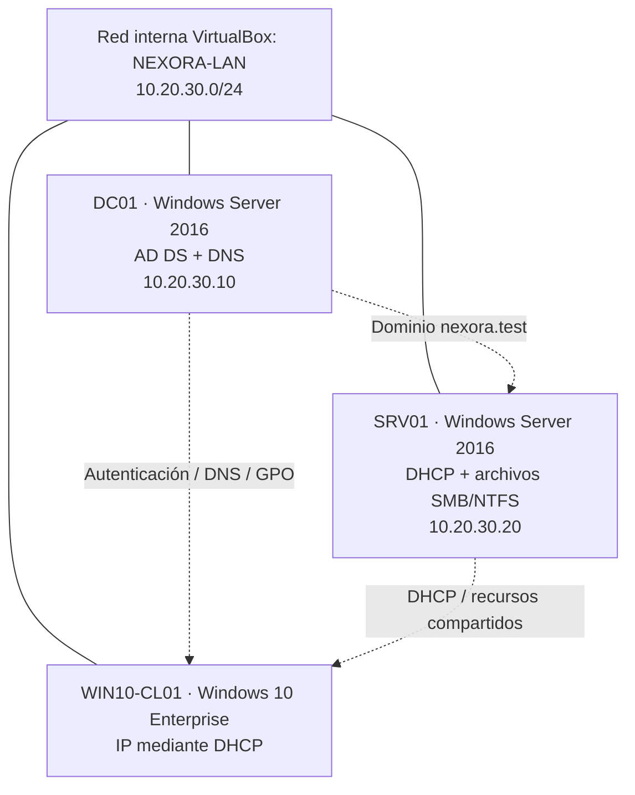

# Arquitectura lógica — Nexora Solutions

La red se diseñó sin adaptador puente ni acceso directo desde estas VM a la LAN doméstica. Un segundo cliente es una ampliación prevista, no una máquina demostrada en el material revisado.
