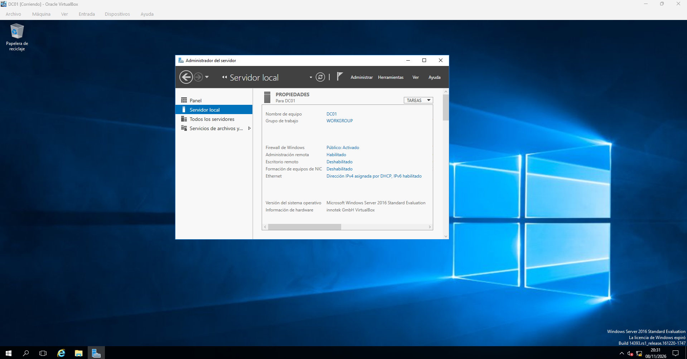
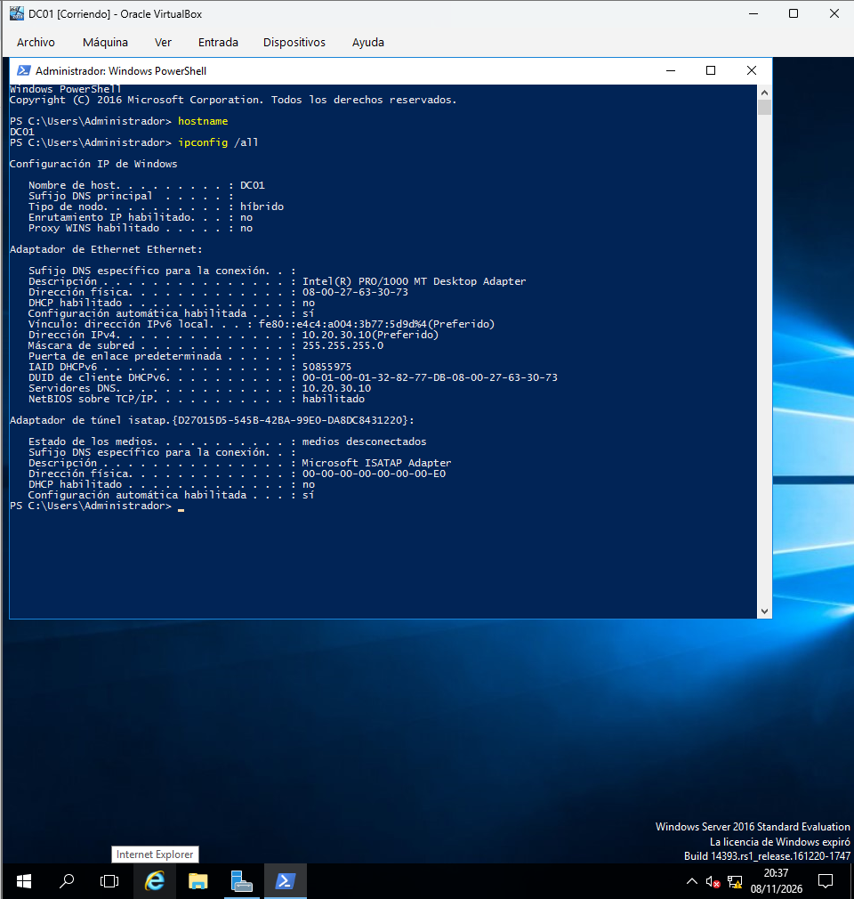
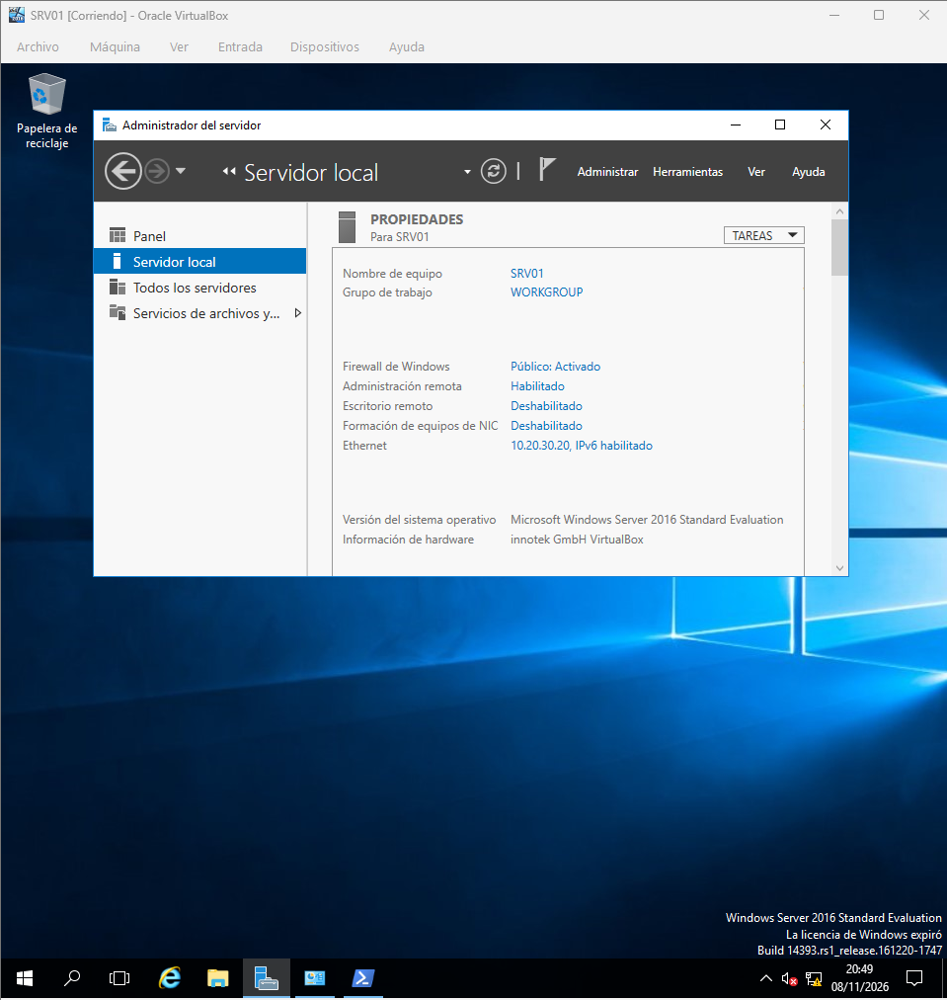
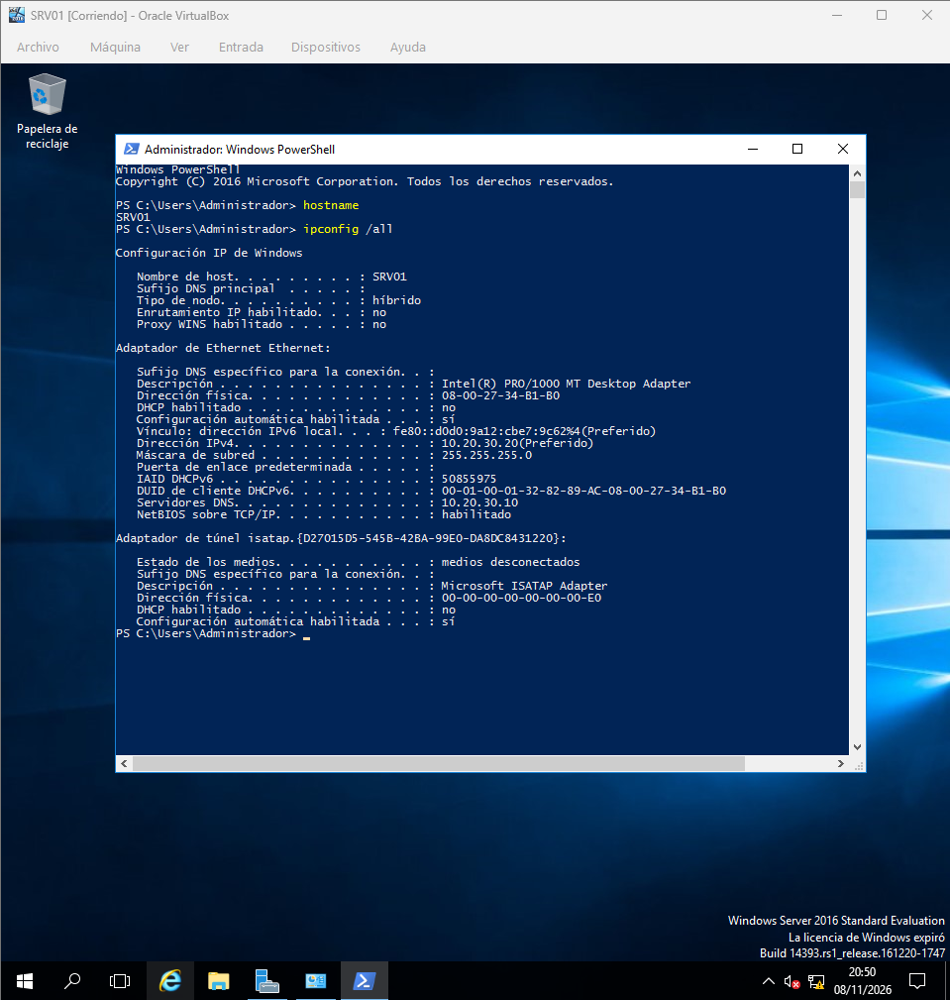
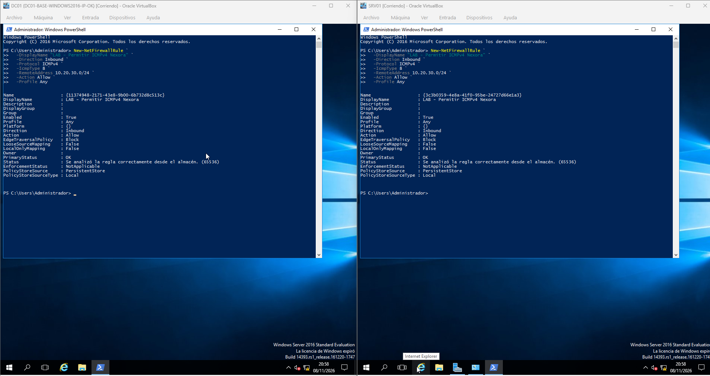
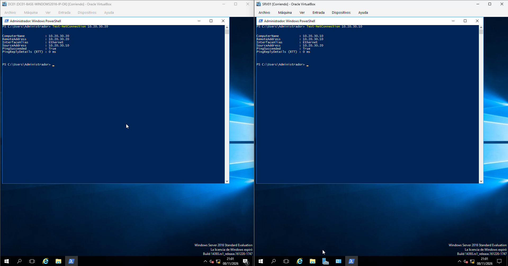
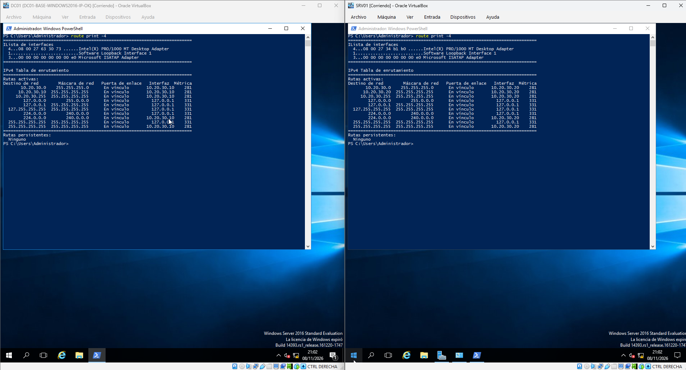
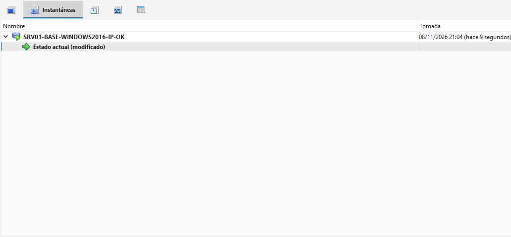

# Fase 02 — Virtualización y red aislada

## Objetivo

Crear la infraestructura base de **Nexora Solutions** en Oracle VirtualBox sobre un equipo Windows 11, asegurando conectividad entre servidores sin exponer los servicios del laboratorio a la red doméstica.

## Arquitectura y direccionamiento

| Parámetro | DC01 | SRV01 |
|---|---|---|
| Sistema operativo | Windows Server 2016 Standard Evaluation | Windows Server 2016 Standard Evaluation |
| RAM | 4 GB | 4 GB |
| vCPU | 2 | 2 |
| Disco virtual | 50 GB VDI dinámico | 50 GB VDI dinámico |
| IP | `10.20.30.10` | `10.20.30.20` |
| Máscara | `255.255.255.0` | `255.255.255.0` |
| Puerta de enlace | Sin configurar | Sin configurar |
| DNS interno | `10.20.30.10` | `10.20.30.10` |

**Configuración de VirtualBox:** adaptador 1 en modalidad **Red interna**, nombre exacto `NEXORA-LAN`, sin adaptadores adicionales activos durante las pruebas de aislamiento.

## Procedimiento

1. Crear las máquinas `DC01` y `SRV01` con discos VDI de crecimiento dinámico.
2. Instalar Windows Server 2016 con *Desktop Experience*.
3. Configurar el nombre de cada servidor y asignar IP estática.
4. Comprobar la dirección y el nombre con `hostname` e `ipconfig /all`.
5. Probar conectividad en ambos sentidos con `Test-NetConnection`.
6. Ante los primeros fallos ICMP, mantener activo el firewall y añadir una regla de entrada para solicitudes echo IPv4 **limitada a `10.20.30.0/24`**.
7. Repetir ambas pruebas y verificar `PingSucceeded: True`.
8. Comprobar rutas IPv4 con `route print -4` y guardar instantáneas base de las máquinas.

## Pruebas y resultados

| Prueba | Comando | Evidencia observada |
|---|---|---|
| Identidad del servidor | `hostname` | `DC01` y `SRV01` |
| Direccionamiento estático | `ipconfig /all` | `10.20.30.10/24` y `10.20.30.20/24`, DHCP deshabilitado en ambos servidores |
| Conectividad inicial | `Test-NetConnection <IP-del-otro-servidor>` | `PingSucceeded: False` |
| Conectividad tras ajuste del firewall | Mismo comando en ambos sentidos | `PingSucceeded: True` |
| Rutas locales | `route print -4` | Captura de comprobación disponible; revisar contenido antes de afirmar aislamiento completo |

> **Alcance de la prueba:** el ping bidireccional demuestra conectividad entre máquinas virtuales, pero por sí solo no certifica el aislamiento externo. Para ello deben comprobarse también la modalidad Red interna y las rutas del equipo.

## Incidencia 001 — ICMP bloqueado

**Síntoma:** ambos servidores tenían las IP correctas, pero `Test-NetConnection` devolvía `PingSucceeded: False`.

**Intervención:** se creó en cada servidor una regla de firewall de entrada, protocolo ICMPv4 y tipo echo request (8), permitiendo solo orígenes de la subred `10.20.30.0/24`. No se desactivó globalmente Windows Firewall.

```powershell
New-NetFirewallRule `
  -DisplayName "LAB - Permitir ICMPv4 Nexora" `
  -Direction Inbound `
  -Protocol ICMPv4 `
  -IcmpType 8 `
  -RemoteAddress 10.20.30.0/24 `
  -Action Allow `
  -Profile Any
```

**Resultado:** la comunicación entre `DC01` y `SRV01` funcionó en ambos sentidos.

## Aprendizajes

- Diferencia entre configuración IP y conectividad efectiva.
- Aislamiento por topología de red virtual y ausencia de salida directa.
- Diagnóstico de tráfico ICMP bloqueado sin apagar el firewall.
- Importancia de conservar evidencias del fallo y de la solución.

---

## Guía práctica ilustrada

Cada paso combina **acción**, **justificación** y **comprobación**. Las capturas se presentan junto a su explicación: las pruebas de mayor valor quedan visibles y los pasos preparatorios pueden desplegarse al pulsar «Ver captura».

## Preparación de los dos servidores

### Paso 1 — Instalación de DC01

**Qué hicimos.** Instalamos Windows Server 2016 Standard con entorno gráfico en DC01 y verificamos el nombre del equipo.

**Por qué.** Separar el controlador de dominio desde el principio simplifica la administración y el diagnóstico.

**Cómo lo verificamos.** Comprobar que Server Manager corresponde a DC01.

<details>
<summary>📷 Ver evidencia — Instalación de DC01</summary>



</details>

### Paso 2 — IP fija de DC01

**Qué hicimos.** Asignamos 10.20.30.10/24 a la interfaz interna, sin gateway, y apuntamos DNS al propio DC01.

**Por qué.** Las direcciones estáticas evitan que el servidor de directorio cambie de localización.

**Cómo lo verificamos.** Revisar IP, máscara y DNS en la consola.

<details>
<summary>📷 Ver evidencia — IP fija de DC01</summary>



</details>

### Paso 3 — Instalación de SRV01

**Qué hicimos.** Instalamos SRV01 como segundo servidor independiente dentro de VirtualBox.

**Por qué.** Los servicios DHCP y de archivos se alojarán fuera del controlador de dominio.

**Cómo lo verificamos.** Comprobar que la instalación termina sin errores.

<details>
<summary>📷 Ver evidencia — Instalación de SRV01</summary>



</details>

### Paso 4 — IP fija de SRV01

**Qué hicimos.** Asignamos 10.20.30.20/24 y como DNS 10.20.30.10.

**Por qué.** El servidor miembro debe consultar el DNS de Active Directory, no un resolutor público.

**Cómo lo verificamos.** Las dos IP deben pertenecer a la subred 10.20.30.0/24.



## Diagnóstico de conectividad y recuperación

### Paso 5 — Regla de firewall ICMP

**Qué hicimos.** Al fallar las primeras pruebas ICMP, creamos una regla de entrada para echo request (tipo 8) con origen limitado a 10.20.30.0/24.

**Por qué.** Un ping fallido puede deberse al firewall del host aunque la capa de red funcione; no es necesario desactivarlo.

**Cómo lo verificamos.** Confirmar que el ámbito de origen de la regla es la red del laboratorio.

<details>
<summary>📷 Ver evidencia — Regla de firewall ICMP</summary>



</details>

### Paso 6 — Conectividad entre servidores

**Qué hicimos.** Repetimos Test-NetConnection en ambos sentidos tras ajustar el firewall.

**Por qué.** La corrección se valida repitiendo exactamente la prueba que falló.

**Cómo lo verificamos.** Buscar PingSucceeded: True en DC01 hacia SRV01 y viceversa.



### Paso 7 — Rutas internas

**Qué hicimos.** Inspeccionamos route print -4 para conocer las rutas presentes en la VM.

**Por qué.** Una prueba ICMP entre equipos no prueba por sí sola que el laboratorio esté aislado del anfitrión.

**Cómo lo verificamos.** Comprobar también que VirtualBox usa Red interna, sin un adaptador puente inesperado.

<details>
<summary>📷 Ver evidencia — Rutas internas</summary>



</details>

### Paso 8 — Instantánea de SRV01

**Qué hicimos.** Creamos una instantánea de SRV01 antes de instalar nuevos roles.

**Por qué.** Las instantáneas permiten regresar a un estado estable tras errores de configuración.

**Cómo lo verificamos.** Identificar la instantánea y su punto del despliegue.

<details>
<summary>📷 Ver evidencia — Instantánea de SRV01</summary>



</details>

---

### Resultado y límites de la fase

**Interpretación:** la captura acredita el paso indicado en el entorno de laboratorio. La validez del servicio completo requiere además las verificaciones descritas en esta fase.

[↑ Volver a la portada](../../README.md) · [Consultar el inventario de evidencias](../evidencias.md)
