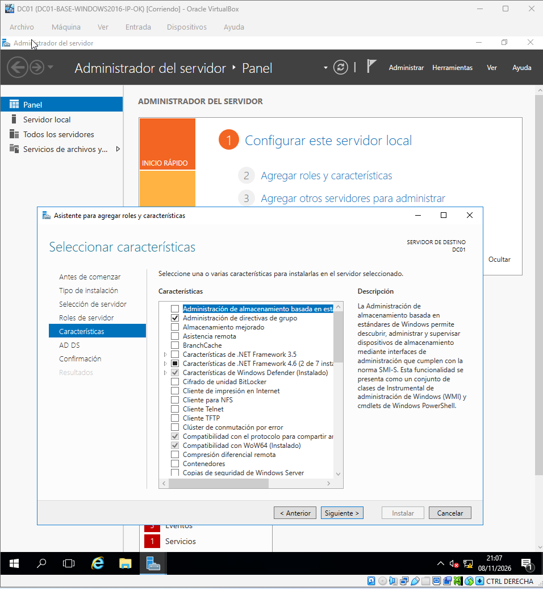
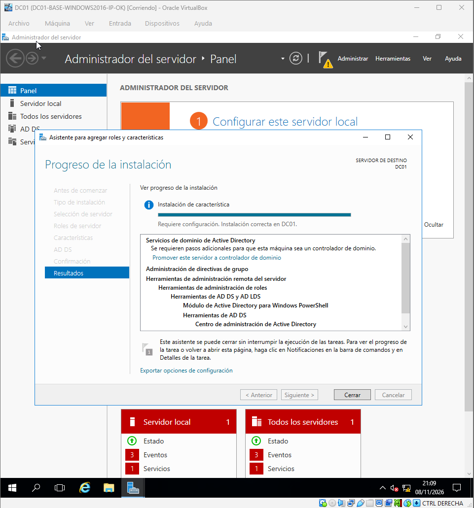
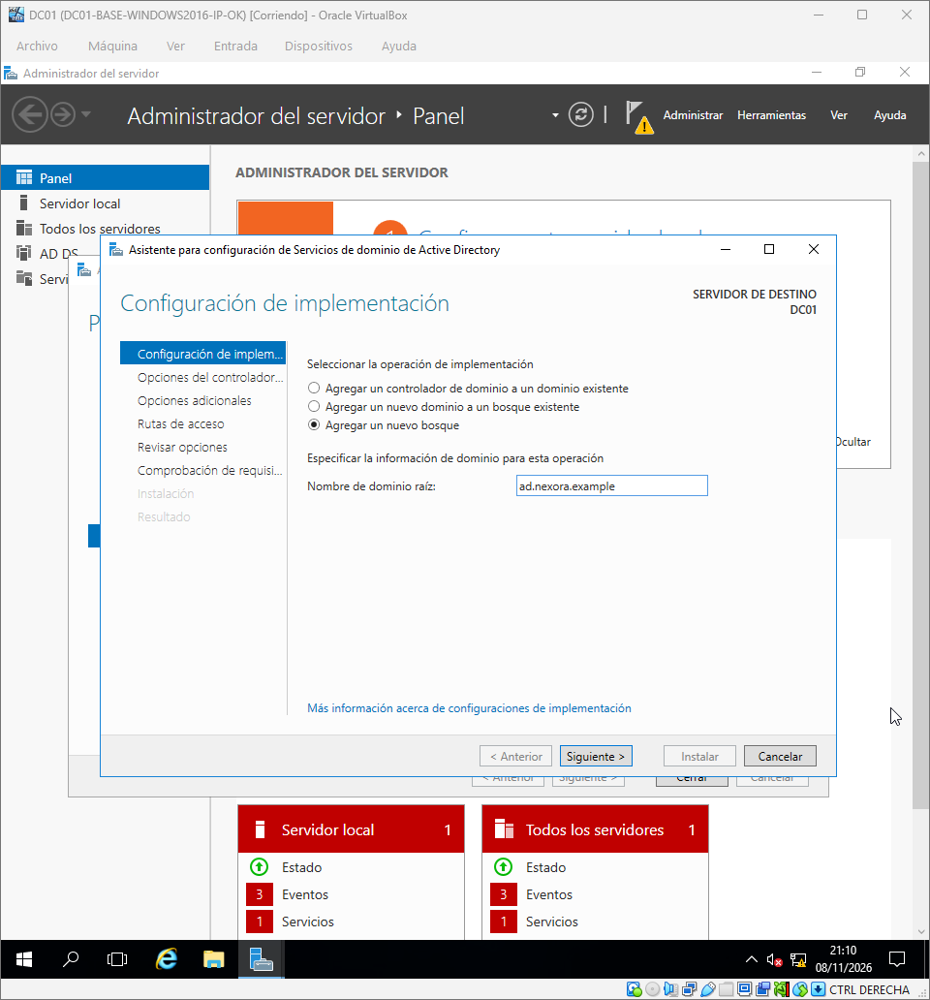
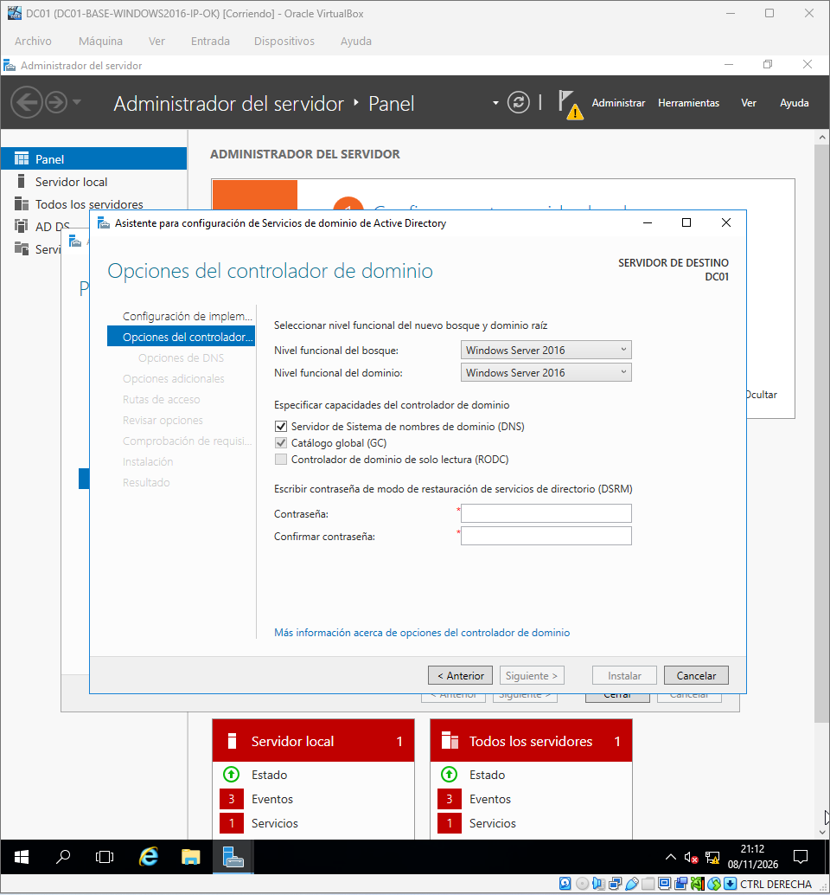
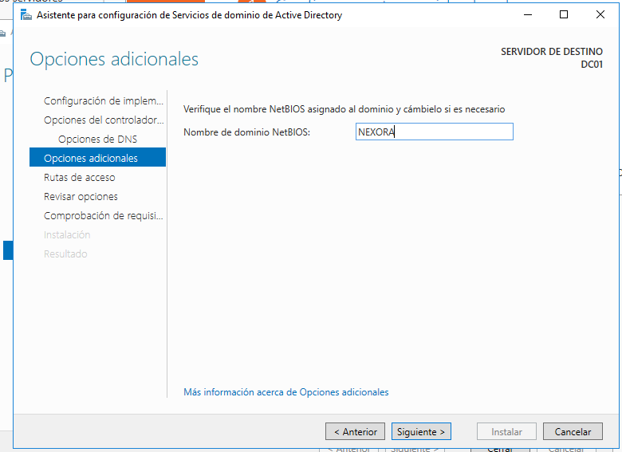
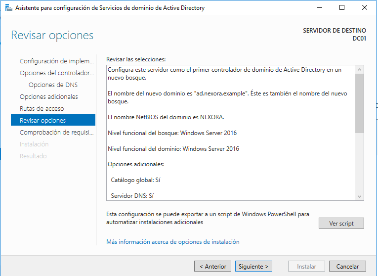
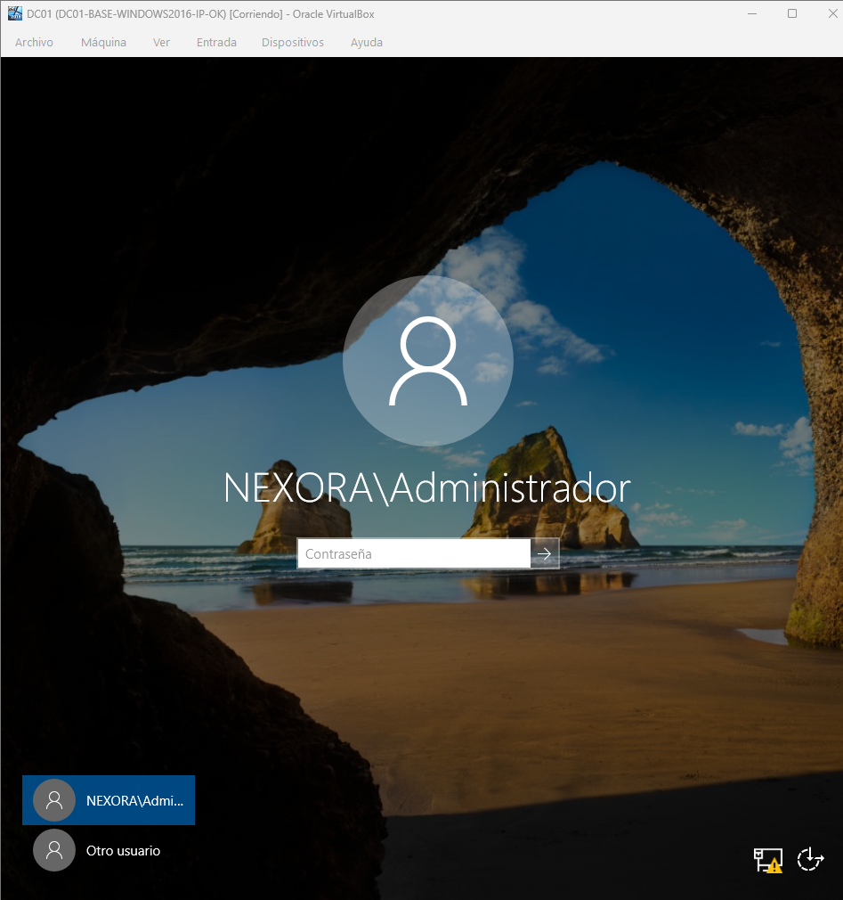
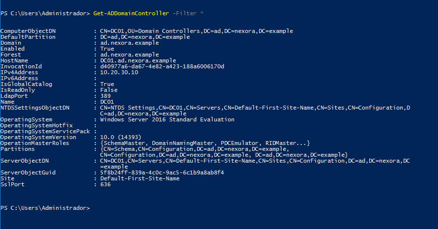
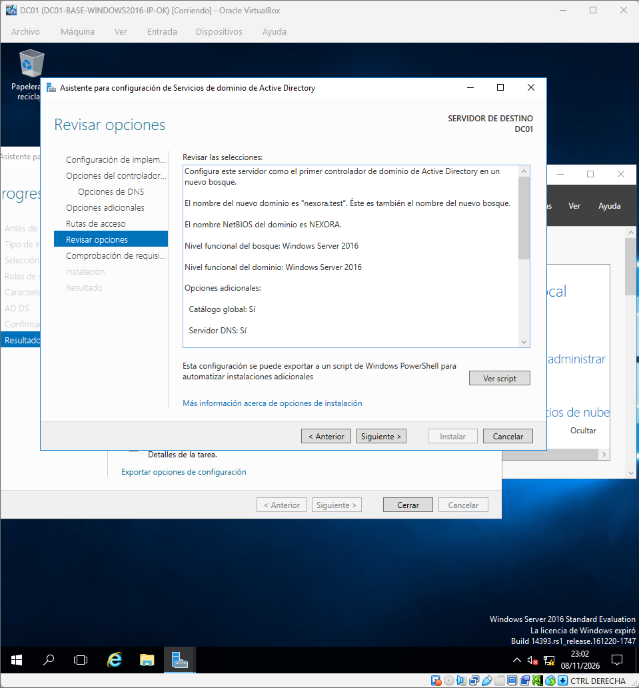
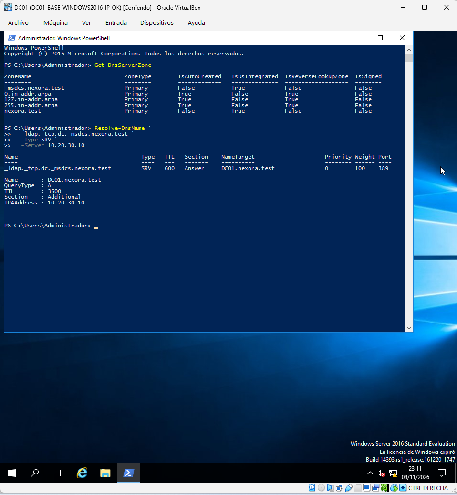

# Fase 03 — Active Directory y DNS

## Diseño final

- Primer controlador de dominio: `DC01`.
- Bosque y dominio: `nexora.test`.
- Nombre NetBIOS: `NEXORA`.
- Nivel funcional: Windows Server 2016.
- DNS instalado en el controlador de dominio, con zonas integradas en AD.

## Verificación documentada

Se observó la zona `nexora.test` y la zona `_msdcs.nexora.test`, ambas integradas en Active Directory. La consulta de DNS para `_ldap._tcp.dc._msdcs.nexora.test` devolvió el registro SRV de `DC01.nexora.test` y la dirección `10.20.30.10`.

## Incidencia durante el despliegue

La primera promoción con el nombre `ad.nexora.example` presentó ausencia de zonas DNS y el error `WIN32 123` al crearlas. El dominio se recuperó restaurando la instantánea anterior y creando `nexora.test`. Véase [incidencia DNS](../troubleshooting/002-dns-zonas.md).

## Comprobaciones adicionales

Para cerrar una validación de salud completa conviene guardar los resultados completos de `dcdiag` y comprobar que los servicios DNS, NTDS y Netlogon permanecen iniciados.

---

## Guía práctica ilustrada

Cada paso combina **acción**, **justificación** y **comprobación**. Las capturas se presentan junto a su explicación: las pruebas de mayor valor quedan visibles y los pasos preparatorios pueden desplegarse al pulsar «Ver captura».

## Instalación inicial del rol

### Paso 1 — Selección de AD DS

**Qué hicimos.** Instalamos el rol Active Directory Domain Services desde el asistente de roles.

**Por qué.** El rol prepara los componentes del directorio, pero por sí solo no convierte el servidor en controlador de dominio.

**Cómo lo verificamos.** Identificar AD DS como rol seleccionado.

📷 Ver evidencia — Selección de AD DS

### Paso 2 — Rol instalado

**Qué hicimos.** Finalizamos la instalación y comprobamos que aparece la opción de promover el servidor.

**Por qué.** La promoción es una operación posterior y distinta de instalar el rol.

**Cómo lo verificamos.** Confirmar resultado satisfactorio antes de continuar.

📷 Ver evidencia — Rol instalado

## Primer intento y diagnóstico

### Paso 3 — Diseño del bosque inicial

**Qué hicimos.** Iniciamos un bosque nuevo, inicialmente con el nombre ad.nexora.example.

**Por qué.** La primera promoción forma parte del historial de diagnóstico, no de la configuración vigente.

**Cómo lo verificamos.** No confundir este nombre inicial con el dominio final nexora.test.

📷 Ver evidencia — Diseño del bosque inicial

### Paso 4 — Opciones del controlador

**Qué hicimos.** Seleccionamos nivel funcional Windows Server 2016, DNS y catálogo global en DC01.

**Por qué.** Estos elementos proporcionan autenticación, localización de servicios y datos del directorio.

**Cómo lo verificamos.** Revisar opciones del controlador sin publicar contraseñas DSRM.

📷 Ver evidencia — Opciones del controlador

### Paso 5 — Nombre NetBIOS

**Qué hicimos.** Revisamos el nombre NetBIOS NEXORA asignado al bosque.

**Por qué.** NetBIOS se utiliza todavía en ciertas referencias de inicio de sesión y compatibilidad.

**Cómo lo verificamos.** Relacionarlo con NEXORA\Administrador y el nombre DNS.

📷 Ver evidencia — Nombre NetBIOS

### Paso 6 — Revisión de la primera promoción

**Qué hicimos.** Comprobamos la configuración antes de promover el primer bosque.

**Por qué.** Una revisión previa evita consolidar errores de nombre o ubicación de datos.

**Cómo lo verificamos.** Esta evidencia corresponde a la promoción inicial que tuvo problemas DNS.

📷 Ver evidencia — Revisión de la primera promoción

### Paso 7 — Inicio de sesión en dominio

**Qué hicimos.** Probamos el inicio de sesión con el contexto de dominio tras la promoción.

**Por qué.** Autenticarse en el dominio no demuestra por sí solo que DNS esté bien configurado.

**Cómo lo verificamos.** Complementar siempre con consultas DNS y pruebas de salud AD.

📷 Ver evidencia — Inicio de sesión en dominio

### Paso 8 — Consulta de Active Directory

**Qué hicimos.** Consultamos propiedades del directorio mientras investigamos la ausencia de zonas.

**Por qué.** Un directorio accesible puede coexistir con un servicio DNS incompleto.

**Cómo lo verificamos.** Véase la incidencia 002 para pruebas, eventos y límites del diagnóstico.

📷 Ver evidencia — Consulta de Active Directory

## Reconstrucción y validación del dominio definitivo

### Paso 9 — Promoción recuperada

**Qué hicimos.** Recuperamos la instantánea pre-AD DS y promovemos DC01 con el bosque definitivo nexora.test.

**Por qué.** Un cambio controlado a un estado anterior es adecuado en un laboratorio sin clientes ni identidades relevantes incorporados.

**Cómo lo verificamos.** El dominio final del proyecto es nexora.test; documentar la recuperación sin inventar una causa raíz.

### Paso 10 — DNS recuperado

**Qué hicimos.** Verificamos con Get-DnsServerZone las zonas nexora.test y _msdcs.nexora.test, y consultamos el SRV LDAP.

**Por qué.** Los equipos necesitan registros SRV para localizar los controladores de dominio.

**Cómo lo verificamos.** La respuesta debe apuntar a DC01.nexora.test y a 10.20.30.10.

---

### Resultado y límites de la fase

**Interpretación:** la captura acredita el paso indicado en el entorno de laboratorio. La validez del servicio completo requiere además las verificaciones descritas en esta fase.

[↑ Volver a la portada](../../README.md) · [Consultar el inventario de evidencias](../evidencias.md)
