# Fase 04 — Estructura organizativa, usuarios y grupos

## Objetivo

Organizar las identidades de Nexora Solutions en Active Directory, diferenciando contenedores organizativos de grupos de autorización.

## Estructura propuesta

```text
nexora.test
└── OU=Empresa
    ├── OU=Usuarios
    │   ├── OU=Direccion
    │   ├── OU=RecursosHumanos
    │   ├── OU=Finanzas
    │   ├── OU=Desarrollo
    │   └── OU=SoporteIT
    ├── OU=Equipos
    │   ├── OU=Estaciones
    │   └── OU=Servidores
    ├── OU=Grupos
    └── OU=CuentasServicio
```

Las OU organizan objetos y permiten vincular GPO o delegar gestión; **no conceden por sí solas permisos sobre carpetas**. Los grupos globales de seguridad representan pertenencia a departamentos.

## Grupos departamentales

| Grupo | Función |
|---|---|
| `GG_Direccion` | Identidades de Dirección |
| `GG_RRHH` | Recursos Humanos |
| `GG_Finanzas` | Finanzas |
| `GG_Desarrollo` | Desarrollo |
| `GG_SoporteIT` | Soporte técnico |

La nomenclatura `GG_` identifica grupos de ámbito global. Los grupos locales de dominio destinados a permisos se documentan en la fase 08.

## Comprobaciones reproducibles

```powershell
Get-ADOrganizationalUnit -SearchBase 'OU=Empresa,DC=nexora,DC=test' -Filter * |
    Select-Object Name, DistinguishedName | Sort-Object DistinguishedName

Get-ADGroup -SearchBase 'OU=Grupos,OU=Empresa,DC=nexora,DC=test' -Filter * |
    Select-Object Name, GroupScope, GroupCategory

Get-ADUser -Filter * -SearchBase 'OU=Usuarios,OU=Empresa,DC=nexora,DC=test' |
    Select-Object Name, SamAccountName, Enabled
```

## Evidencias del laboratorio

El lote de capturas contiene la creación de OU, verificación de su ubicación, grupos departamentales, creación de la primera cuenta y revisión de pertenencias. La lista íntegra de archivos queda en [índice de evidencias](../evidencias.md).

> **Pendiente de verificación exhaustiva:** contrastar nombres y estados de todas las cuentas ficticias con el directorio vivo antes de afirmar que los 60 empleados están creados.

---

## Guía práctica ilustrada

Cada paso combina **acción**, **justificación** y **comprobación**. Las capturas se presentan junto a su explicación: las pruebas de mayor valor quedan visibles y los pasos preparatorios pueden desplegarse al pulsar «Ver captura».

## Estructura de unidades organizativas

### Paso 1 — OU principal Empresa

**Qué hicimos.** Creamos la OU raíz Empresa y activamos la protección frente a eliminación accidental.

**Por qué.** Centralizar la estructura facilita delegación, políticas y mantenimiento.

**Cómo lo verificamos.** Confirmar que cuelga del dominio nexora.test.

<details>
<summary>📷 Ver evidencia — OU principal Empresa</summary>

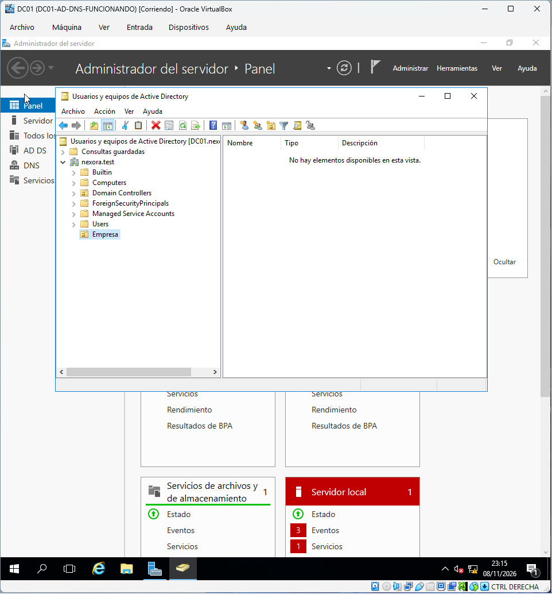

</details>

### Paso 2 — Comprobación del DN

**Qué hicimos.** Comprobamos con Get-ADOrganizationalUnit el DistinguishedName de Empresa.

**Por qué.** El DN identifica la ubicación precisa de cada objeto AD.

**Cómo lo verificamos.** Resultado esperado: OU=Empresa,DC=nexora,DC=test.

<details>
<summary>📷 Ver evidencia — Comprobación del DN</summary>

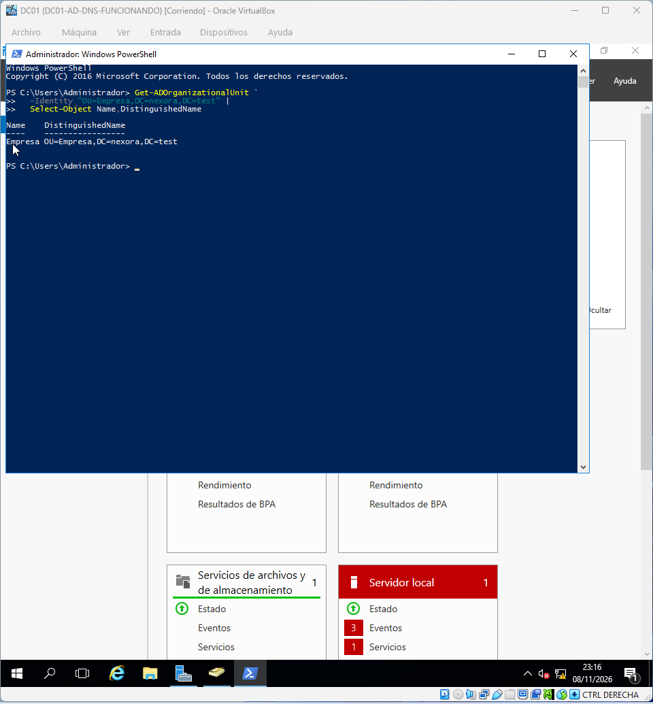

</details>

### Paso 3 — OU principales

**Qué hicimos.** Creamos Usuarios, Equipos, Grupos y CuentasServicio dentro de Empresa.

**Por qué.** Separar tipos de objetos facilita la administración y evita mezclar directivas de equipo y usuario.

**Cómo lo verificamos.** Verificar que son OU hermanas.

<details>
<summary>📷 Ver evidencia — OU principales</summary>

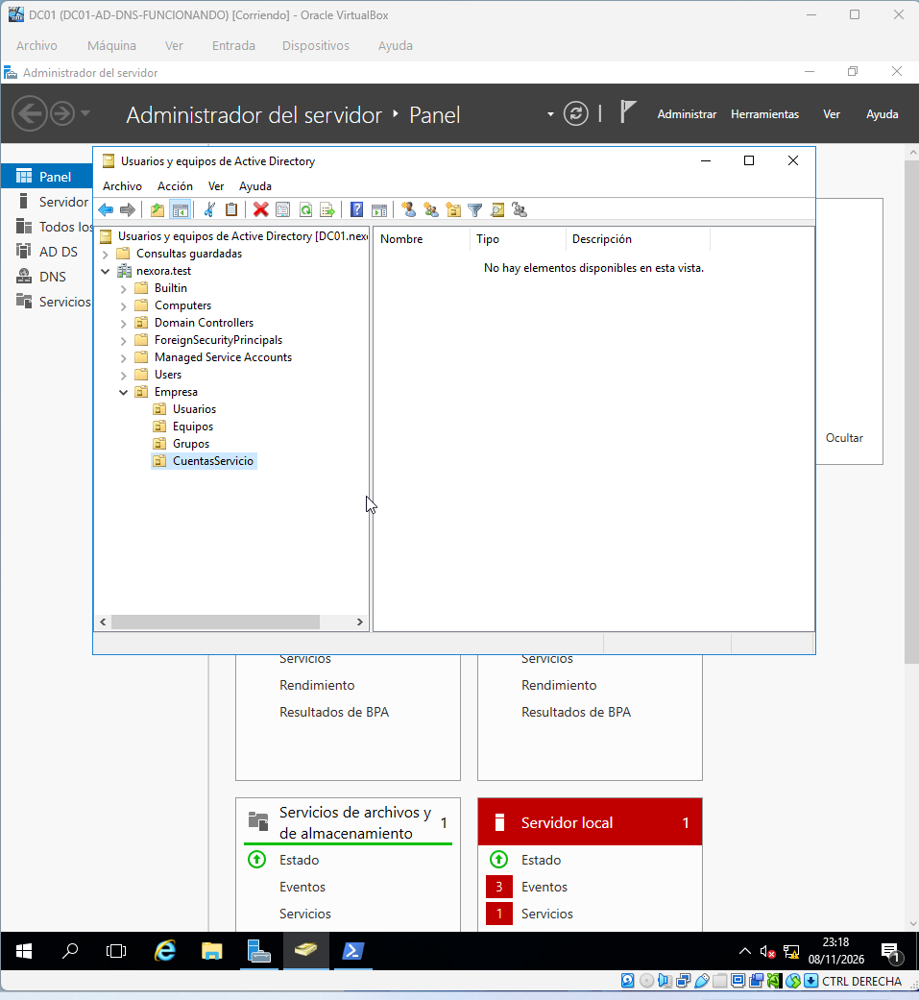

</details>

### Paso 4 — Departamentos

**Qué hicimos.** Creamos las cinco OU departamentales bajo Usuarios.

**Por qué.** Las OU permiten aplicar GPO o delegar tareas por departamento, pero no otorgan permisos sobre archivos.

**Cómo lo verificamos.** Confirmar Dirección, RecursosHumanos, Finanzas, Desarrollo y SoporteIT.


### Paso 5 — Verificación jerárquica

**Qué hicimos.** Consultamos por PowerShell el árbol recién creado.

**Por qué.** Una comprobación por comando ayuda a detectar objetos en ubicaciones equivocadas.

**Cómo lo verificamos.** Revisar los DistinguishedName de las OU.

<details>
<summary>📷 Ver evidencia — Verificación jerárquica</summary>

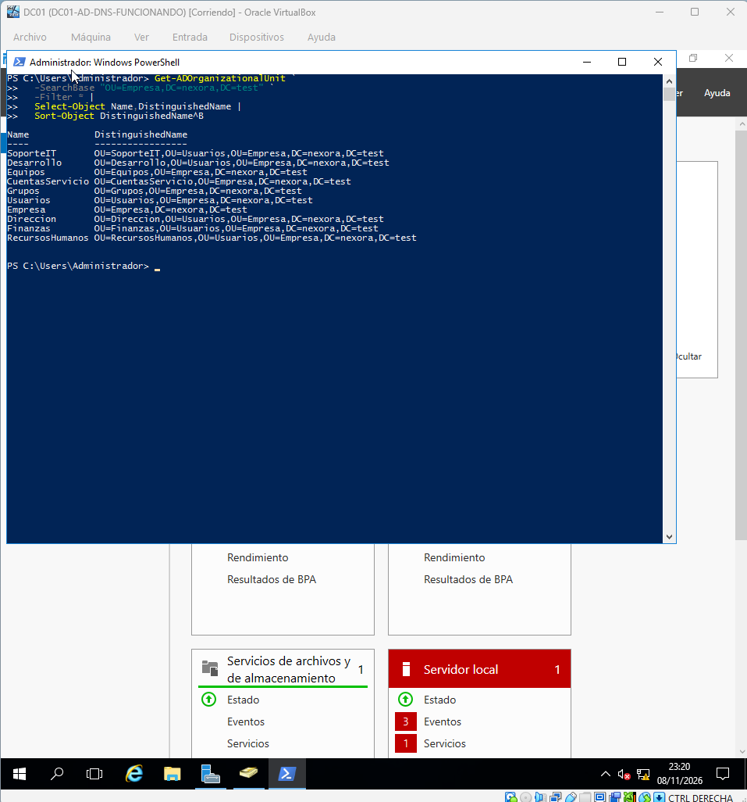

</details>

### Paso 6 — Clasificación de equipos

**Qué hicimos.** Dividimos Equipos en Estaciones y Servidores.

**Por qué.** Las estaciones y los servidores deben recibir políticas diferenciadas.

**Cómo lo verificamos.** DC01 permanece en la OU integrada Domain Controllers; SRV01 se organizará después.

<details>
<summary>📷 Ver evidencia — Clasificación de equipos</summary>

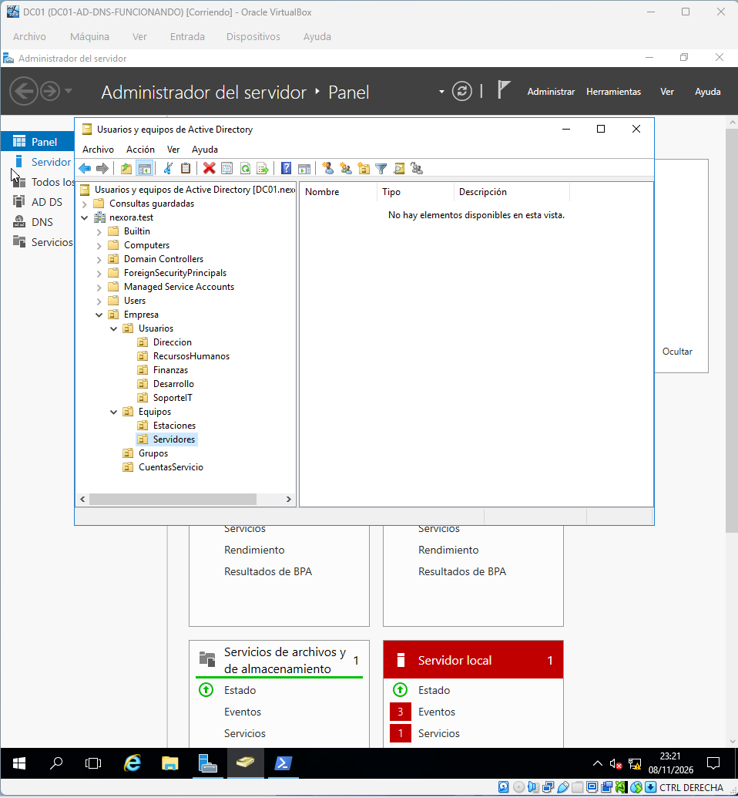

</details>

## Grupos de seguridad

### Paso 7 — Grupos departamentales

**Qué hicimos.** Creamos grupos globales de seguridad, uno por departamento.

**Por qué.** Los grupos representan roles o pertenencias y sirven para conceder acceso sin permisos individuales.

**Cómo lo verificamos.** Buscar los prefijos GG_ con nombres consistentes.

<details>
<summary>📷 Ver evidencia — Grupos departamentales</summary>

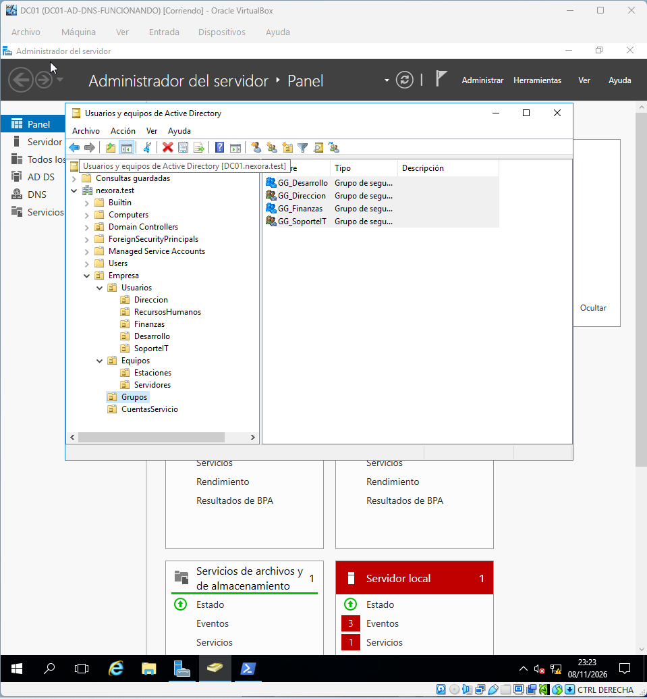

</details>

### Paso 8 — Ámbito y categoría

**Qué hicimos.** Comprobamos GroupScope y GroupCategory de los grupos.

**Por qué.** Un grupo de distribución no sirve para la autorización NTFS del mismo modo que uno de seguridad.

**Cómo lo verificamos.** El ámbito esperado es Global y la categoría Security.


## Cuentas y pertenencias

### Paso 9 — Primer usuario

**Qué hicimos.** Creamos un usuario ficticio en la OU de Dirección.

**Por qué.** Las cuentas deben residir donde corresponden las políticas aplicables a su departamento.

**Cómo lo verificamos.** Comprobar el nombre y la ubicación de la cuenta.

<details>
<summary>📷 Ver evidencia — Primer usuario</summary>

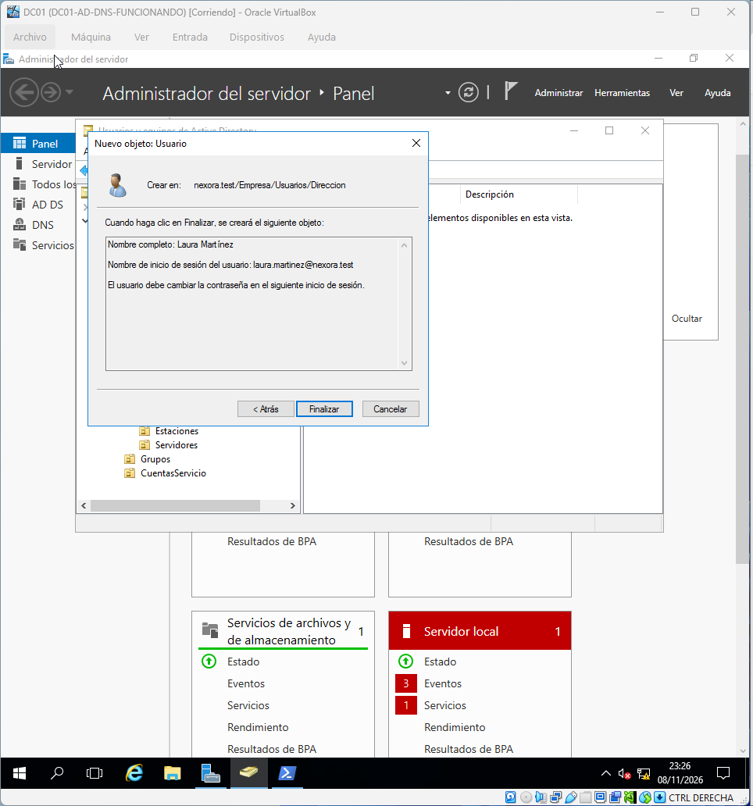

</details>

### Paso 10 — Pertenencia a grupo

**Qué hicimos.** Añadimos el usuario a GG_Direccion.

**Por qué.** La pertenencia al grupo simplifica la asignación posterior de autorizaciones.

**Cómo lo verificamos.** Validar el grupo en Member Of.

<details>
<summary>📷 Ver evidencia — Pertenencia a grupo</summary>

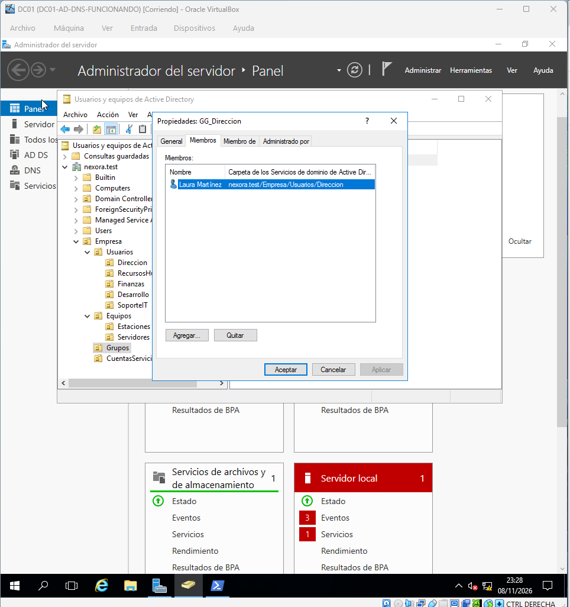

</details>

### Paso 11 — Consulta de usuario

**Qué hicimos.** Verificamos la cuenta de ejemplo mediante Active Directory.

**Por qué.** La creación visual no garantiza que los atributos y el estado sean correctos.

**Cómo lo verificamos.** Revisar Enabled y la OU.

<details>
<summary>📷 Ver evidencia — Consulta de usuario</summary>

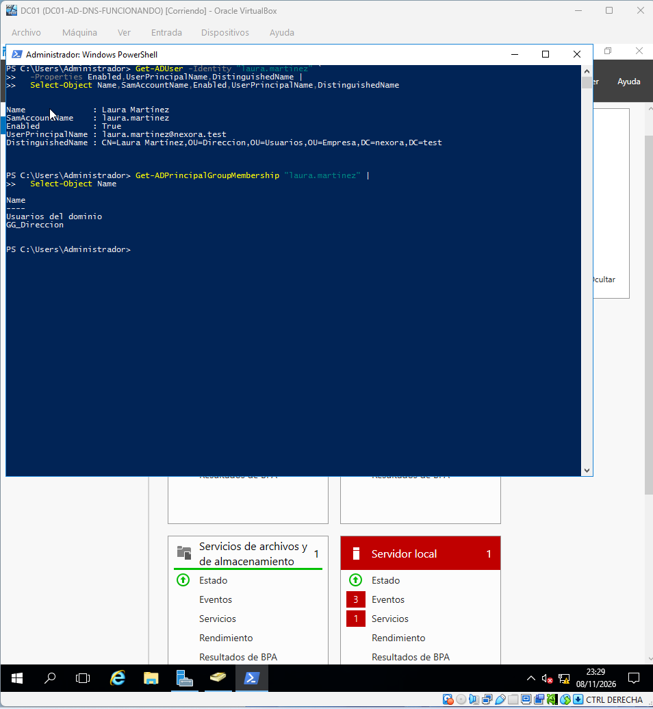

</details>

### Paso 12 — Cuentas por departamento

**Qué hicimos.** Creamos identidades de prueba en otros departamentos.

**Por qué.** El caso simula una organización, pero no implica que existan 60 cuentas verificadas.

**Cómo lo verificamos.** No afirmar altas masivas sin consultar el directorio vivo.

<details>
<summary>📷 Ver evidencia — Cuentas por departamento</summary>

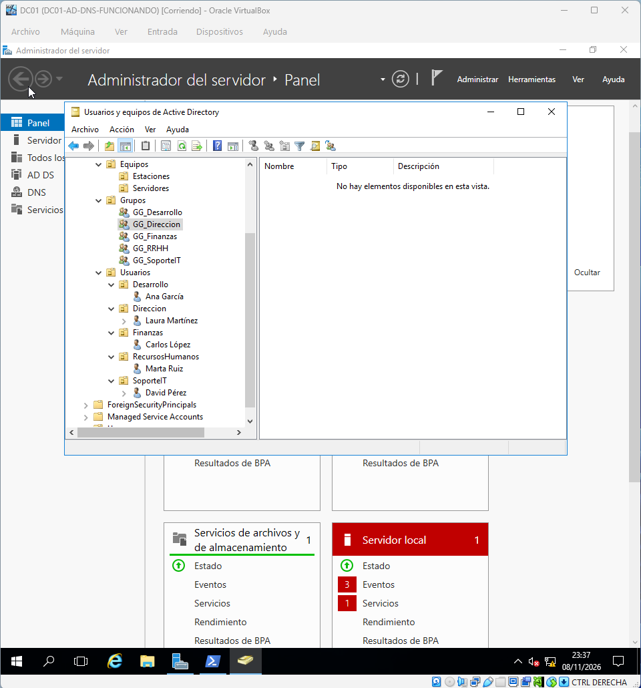

</details>

### Paso 13 — Verificación de empleados

**Qué hicimos.** Revisamos el conjunto de cuentas creadas.

**Por qué.** La inspección permite detectar duplicados o usuarios fuera de su OU.

**Cómo lo verificamos.** Utilizar Get-ADUser para una revisión reproducible.

<details>
<summary>📷 Ver evidencia — Verificación de empleados</summary>

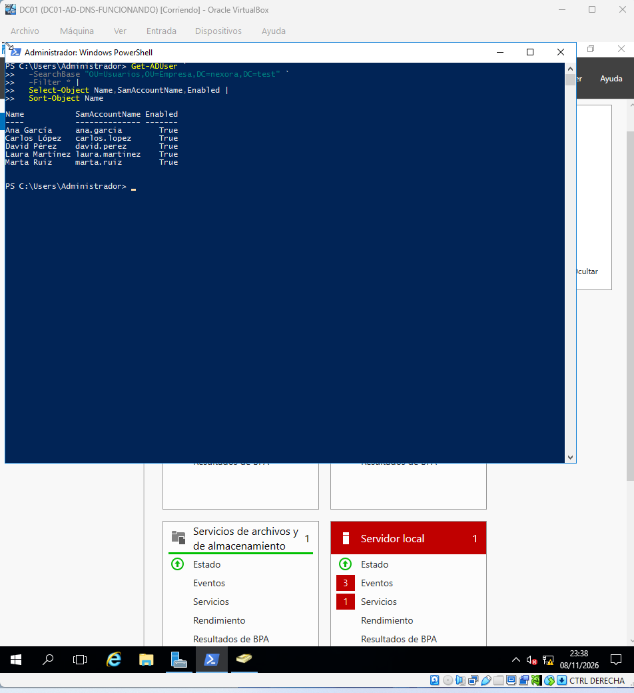

</details>

### Paso 14 — Relaciones usuario-grupo

**Qué hicimos.** Comprobamos las relaciones entre usuarios y grupos departamentales.

**Por qué.** Los permisos se mantendrán a través de grupos, no persona a persona.

**Cómo lo verificamos.** Verificar que cada cuenta tenga las pertenencias justificadas.

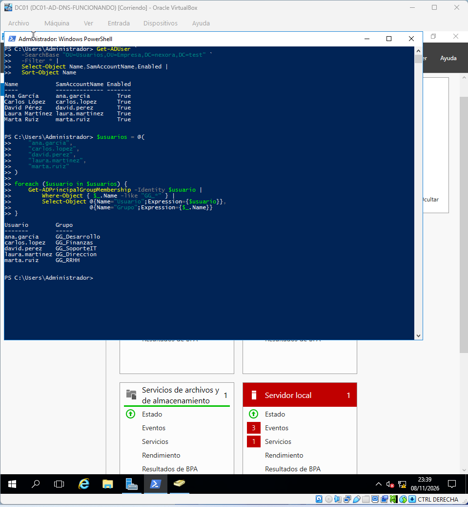

---

### Resultado y límites de la fase

**Interpretación:** la captura acredita el paso indicado en el entorno de laboratorio. La validez del servicio completo requiere además las verificaciones descritas en esta fase.

[↑ Volver a la portada](../../README.md) · [Consultar el inventario de evidencias](../evidencias.md)
