# Fase 05 — Servidor miembro y DHCP

## Objetivo

Integrar `SRV01` en el dominio `nexora.test` y centralizar la entrega de parámetros IP mediante DHCP.

## Diseño

- Controlador de dominio/DNS: `DC01` (`10.20.30.10`).
- Servidor DHCP: `SRV01` (`10.20.30.20`).
- Subred: `10.20.30.0/24`.
- Rango DHCP previsto en el diseño: `10.20.30.100`–`10.20.30.199`.
- DNS que deben recibir los clientes: `10.20.30.10`.
- Sufijo DNS corporativo: `nexora.test`.
- Sin puerta de enlace si se mantiene la red interna aislada y no hay router.

**No configurar otro DHCP** en el mismo segmento (por ejemplo, uno del hipervisor): puede interferir con el ámbito corporativo.

## Procedimiento y pruebas

Las capturas disponibles muestran resolución DNS desde SRV01, proceso de unión al dominio, una incidencia de SID, canal seguro, ubicación en OU, instalación y autorización del rol DHCP y creación/validación de ámbito.

```powershell
# Desde SRV01, tras unirlo al dominio:
Test-ComputerSecureChannel
Get-DhcpServerInDC

# En SRV01, para inspeccionar la configuración:
Get-DhcpServerv4Scope
Get-DhcpServerv4OptionValue -ScopeId 10.20.30.0
Get-DhcpServerv4Lease -ScopeId 10.20.30.0
```

Los nombres, el intervalo efectivo y las opciones DHCP deben cotejarse con el sistema y las capturas antes de convertir esta configuración prevista en especificación definitiva.

## Seguridad

La autorización DHCP en Active Directory evita que un servidor DHCP Windows no autorizado reparta direcciones dentro del dominio. La autorización no sustituye al aislamiento de red.

## Incidencia

Existe evidencia de un error SID durante la unión de SRV01 y de su posterior incorporación correcta. Se documenta como incidencia diferenciada en [troubleshooting](../troubleshooting/003-union-srv01.md).

---

## Guía práctica ilustrada

Cada paso combina **acción**, **justificación** y **comprobación**. Las capturas se presentan junto a su explicación: las pruebas de mayor valor quedan visibles y los pasos preparatorios pueden desplegarse al pulsar «Ver captura».

## Incorporación del servidor al dominio

### Paso 1 — Resolución DNS del servidor miembro

**Qué hicimos.** Probamos la resolución DNS desde SRV01 apuntando al DNS interno.

**Por qué.** La unión al dominio depende de la resolución de servicios AD.

**Cómo lo verificamos.** Comprobar que SRV01 resuelve el dominio y DC01.

<details>
<summary>📷 Ver evidencia — Resolución DNS del servidor miembro</summary>

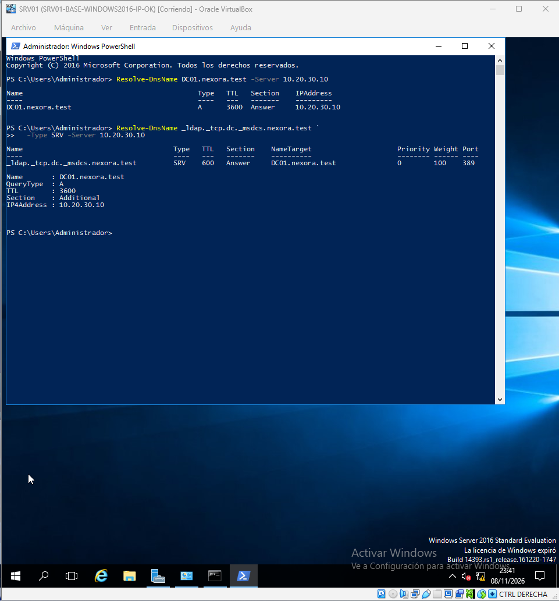

</details>

### Paso 2 — SRV01 unido a dominio

**Qué hicimos.** Completamos la unión de SRV01 al bosque nexora.test.

**Por qué.** Un servidor miembro utiliza identidades y políticas centralizadas sin ser controlador de dominio.

**Cómo lo verificamos.** La evidencia muestra el resultado final de la unión.

<details>
<summary>📷 Ver evidencia — SRV01 unido a dominio</summary>

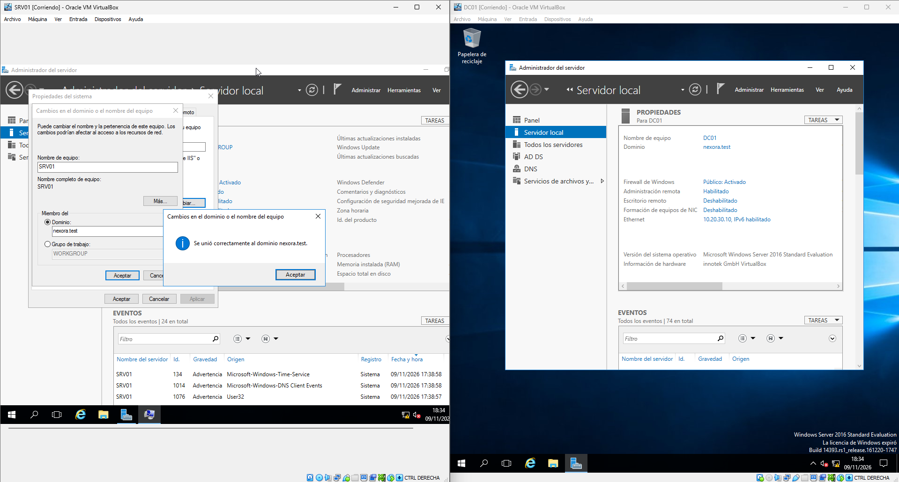

</details>

### Paso 3 — Canal seguro

**Qué hicimos.** Ejecutamos Test-ComputerSecureChannel para revisar la confianza con AD.

**Por qué.** Una unión nominal puede no ser suficiente si falla el canal seguro.

**Cómo lo verificamos.** El resultado esperado es True; revisar la captura para el resultado observado.

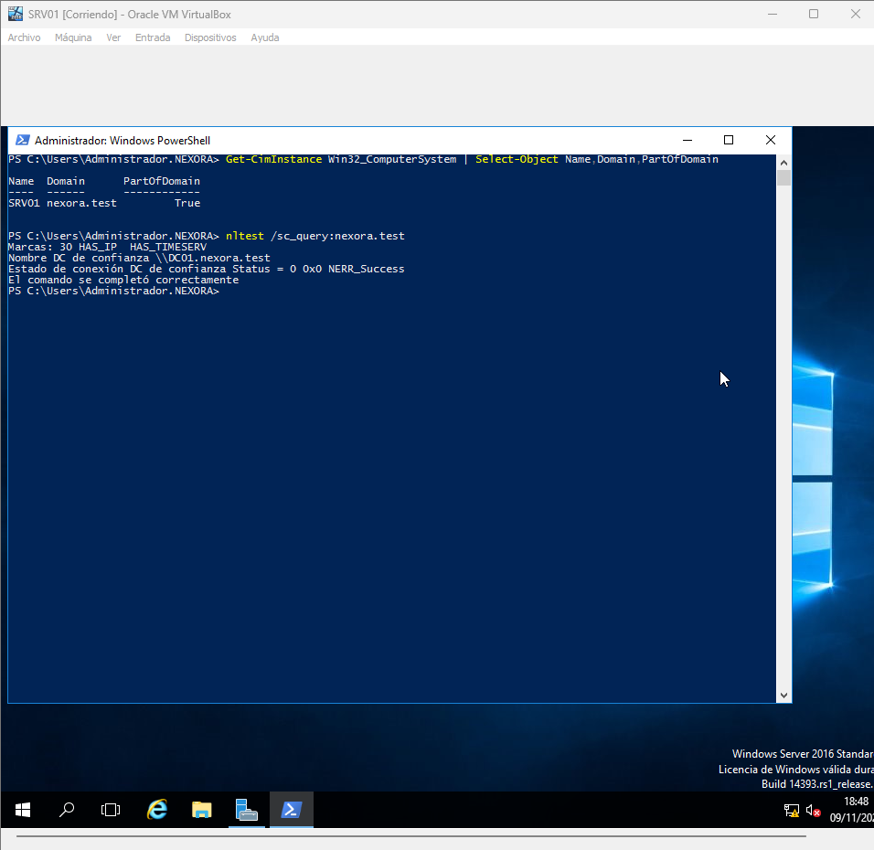

### Paso 4 — OU de servidores

**Qué hicimos.** Movemos el objeto SRV01 a la OU Servidores.

**Por qué.** Esta ubicación permite asignar GPO a servidores miembros sin aplicarlas a DC01.

**Cómo lo verificamos.** Comprobar que SRV01 no se mueve a Domain Controllers.

<details>
<summary>📷 Ver evidencia — OU de servidores</summary>

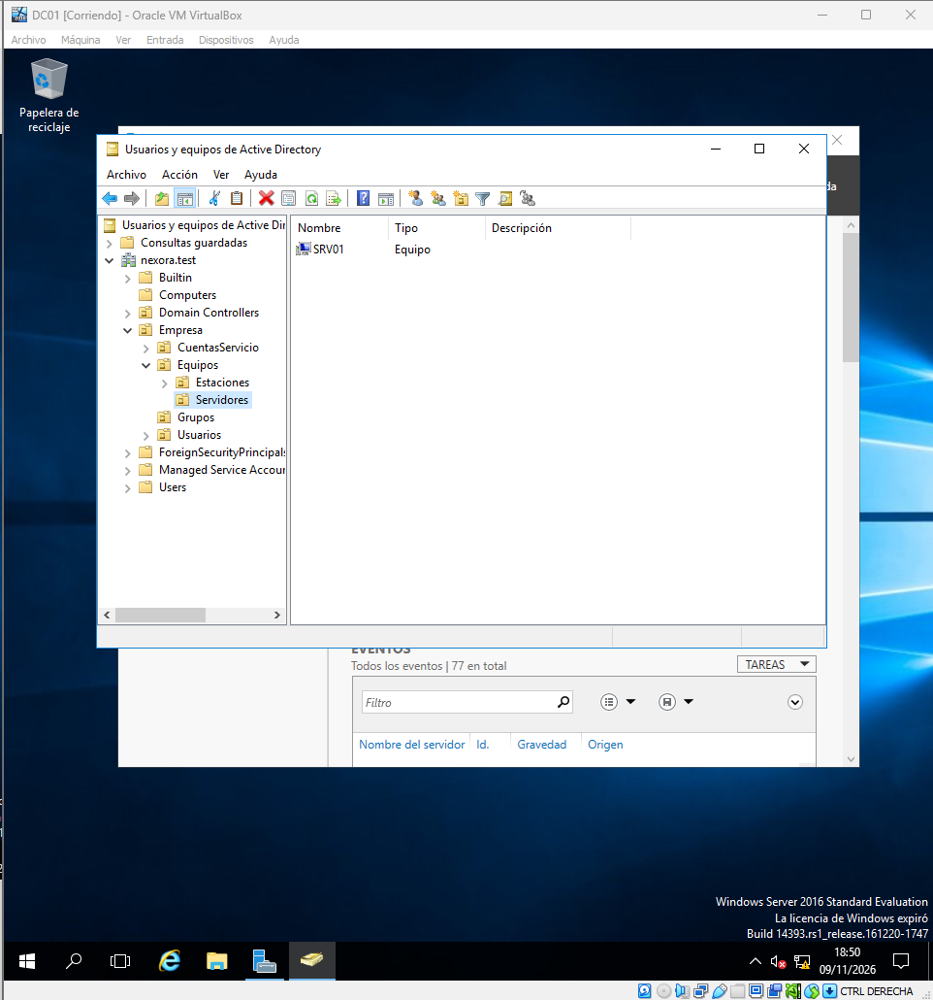

</details>

## Instalación del rol DHCP

### Paso 5 — Selección del rol DHCP

**Qué hicimos.** Seleccionamos el rol DHCP en Server Manager.

**Por qué.** Centralizamos la distribución de direcciones IP para los clientes del laboratorio.

**Cómo lo verificamos.** Distinguir la instalación del rol de su autorización posterior.

<details>
<summary>📷 Ver evidencia — Selección del rol DHCP</summary>

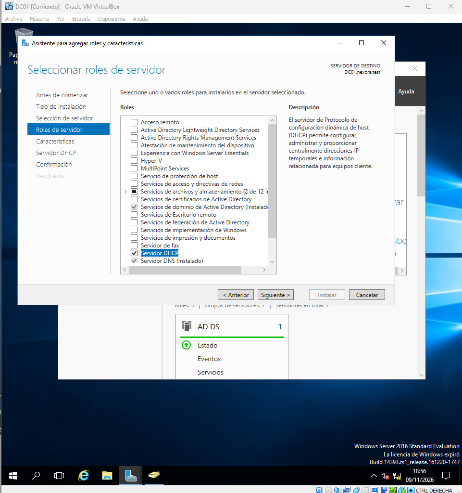

</details>

### Paso 6 — Instalación de DHCP

**Qué hicimos.** Terminamos el asistente de instalación DHCP.

**Por qué.** El servicio debe estar instalado antes de crear y activar ámbitos.

**Cómo lo verificamos.** Revisar que la instalación informe éxito.

<details>
<summary>📷 Ver evidencia — Instalación de DHCP</summary>

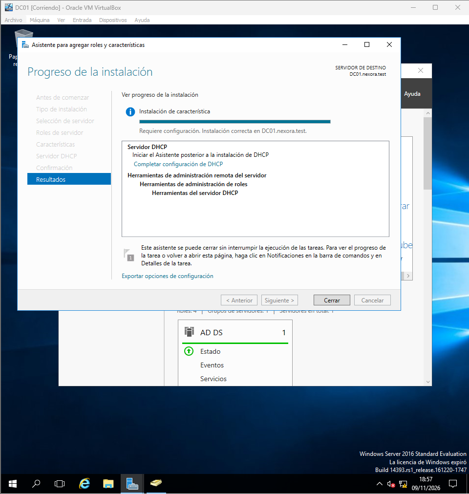

</details>

### Paso 7 — Servidor DHCP operativo

**Qué hicimos.** Abrimos la consola DHCP de SRV01 para administrar IPv4.

**Por qué.** La consola reúne ámbitos, exclusiones, reservas y concesiones.

**Cómo lo verificamos.** Verificar que aparece SRV01 y el nodo IPv4.

<details>
<summary>📷 Ver evidencia — Servidor DHCP operativo</summary>

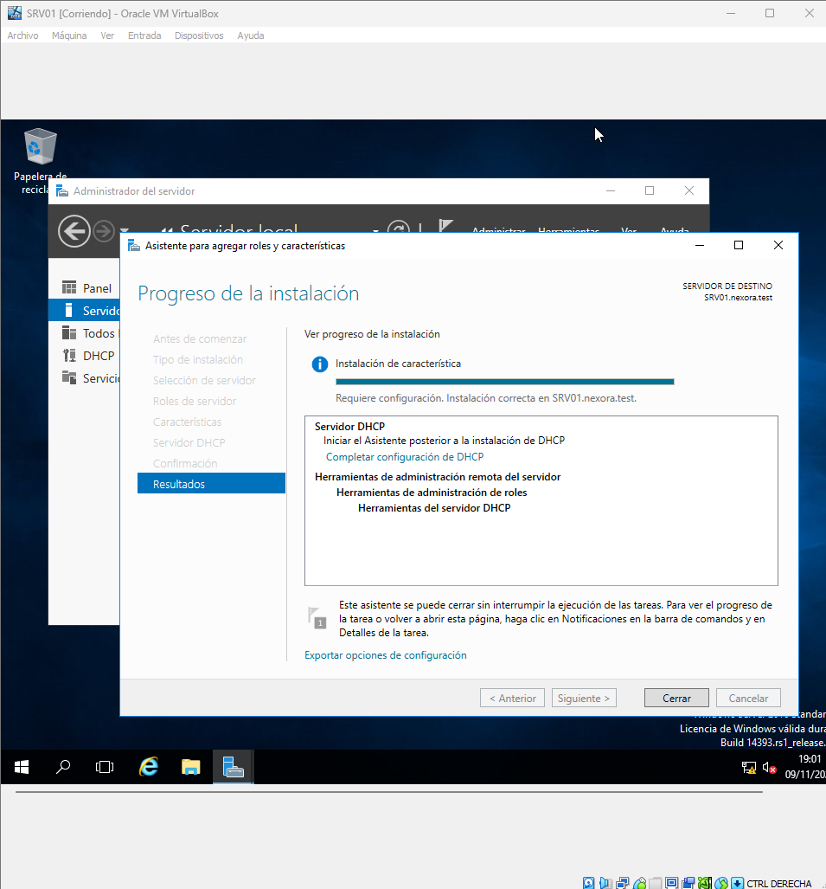

</details>

## Autorización y ámbito IPv4

### Paso 8 — Autorización en AD

**Qué hicimos.** Autorizamos SRV01 como servidor DHCP del dominio en AD.

**Por qué.** La autorización reduce la posibilidad de que servidores Windows no autorizados entreguen configuración.

**Cómo lo verificamos.** No confundir autorización con activar el ámbito.

<details>
<summary>📷 Ver evidencia — Autorización en AD</summary>

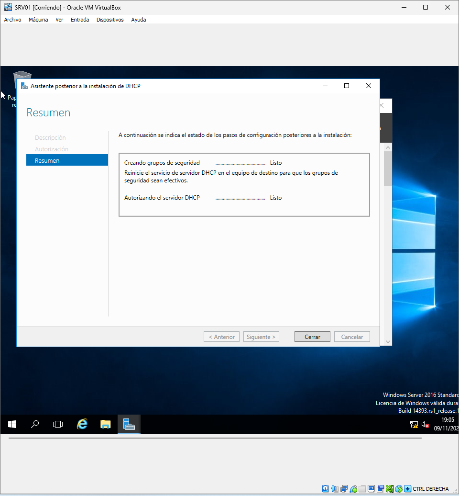

</details>

### Paso 9 — Validación de autorización

**Qué hicimos.** Consultamos la autorización de DHCP desde PowerShell.

**Por qué.** Es una comprobación adicional al asistente gráfico.

**Cómo lo verificamos.** Verificar que la lista contiene SRV01.

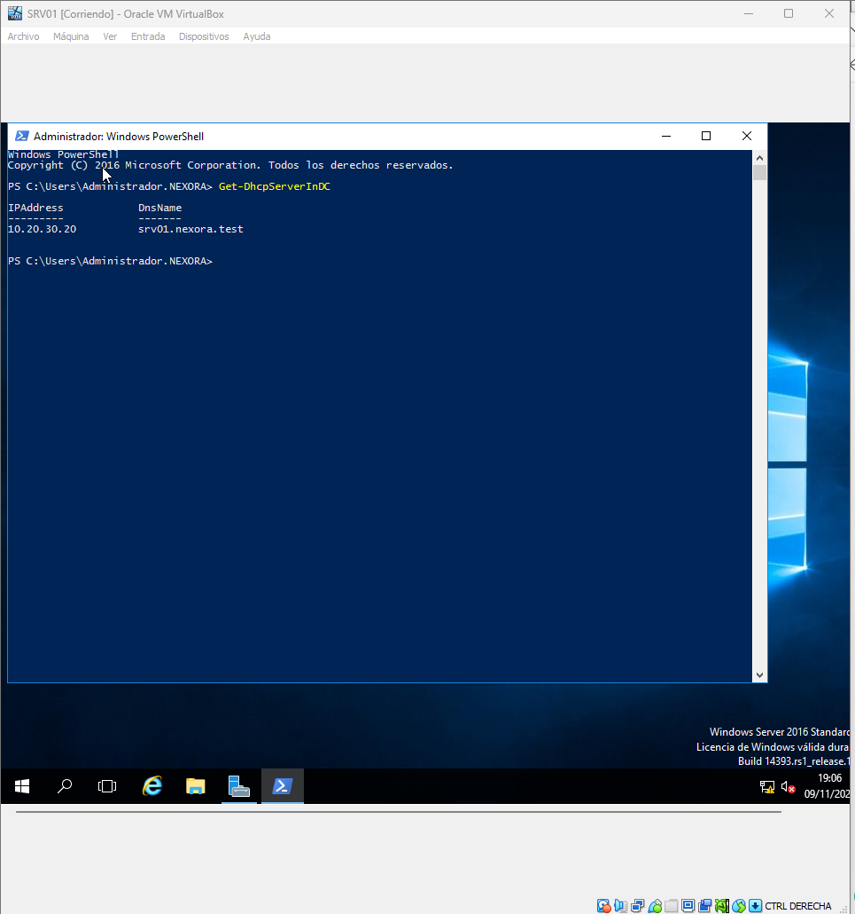

### Paso 10 — Ámbito IPv4

**Qué hicimos.** Definimos el ámbito de la subred y las opciones del cliente.

**Por qué.** Los clientes deben recibir IP, DNS 10.20.30.10 y el sufijo nexora.test; sin gateway si no existe router.

**Cómo lo verificamos.** Revisar el rango efectivo en la captura, no asumir el rango previsto.

<details>
<summary>📷 Ver evidencia — Ámbito IPv4</summary>

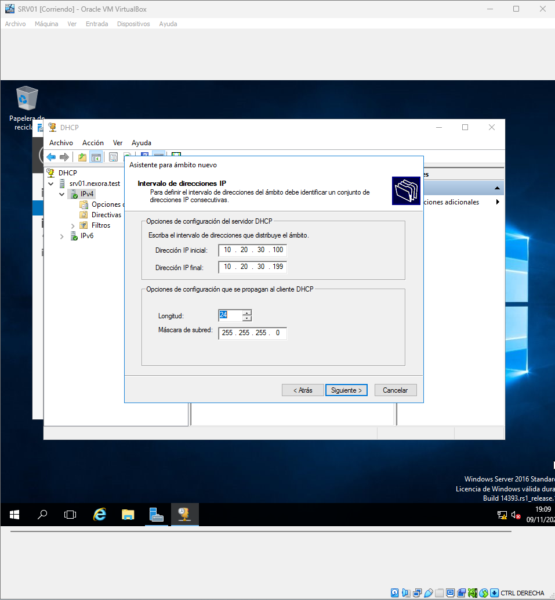

</details>

### Paso 11 — Validación del ámbito

**Qué hicimos.** Consultamos el ámbito configurado para comprobar su estado.

**Por qué.** Antes de conectar Windows 10 conviene verificar que hay direcciones disponibles.

**Cómo lo verificamos.** Comprobar que ámbito y opciones son coherentes con 10.20.30.0/24.

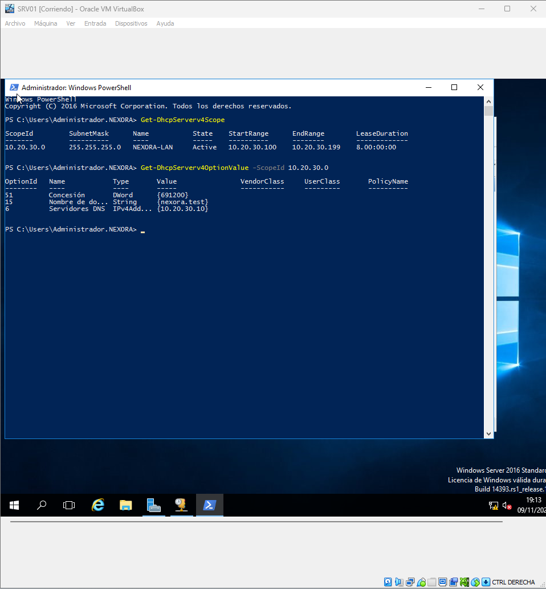

---

### Resultado y límites de la fase

**Interpretación:** la captura acredita el paso indicado en el entorno de laboratorio. La validez del servicio completo requiere además las verificaciones descritas en esta fase.

[↑ Volver a la portada](../../README.md) · [Consultar el inventario de evidencias](../evidencias.md)
