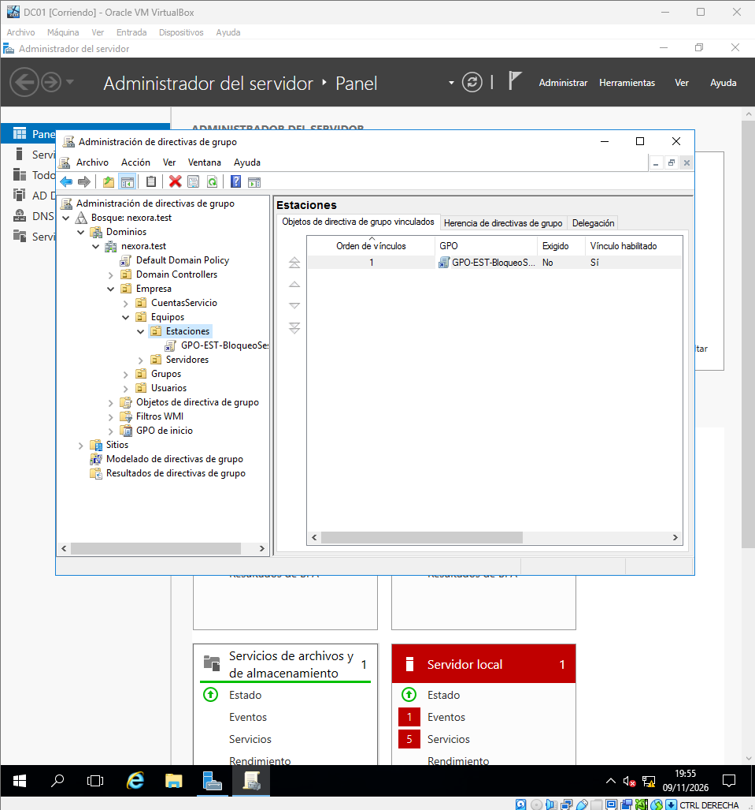
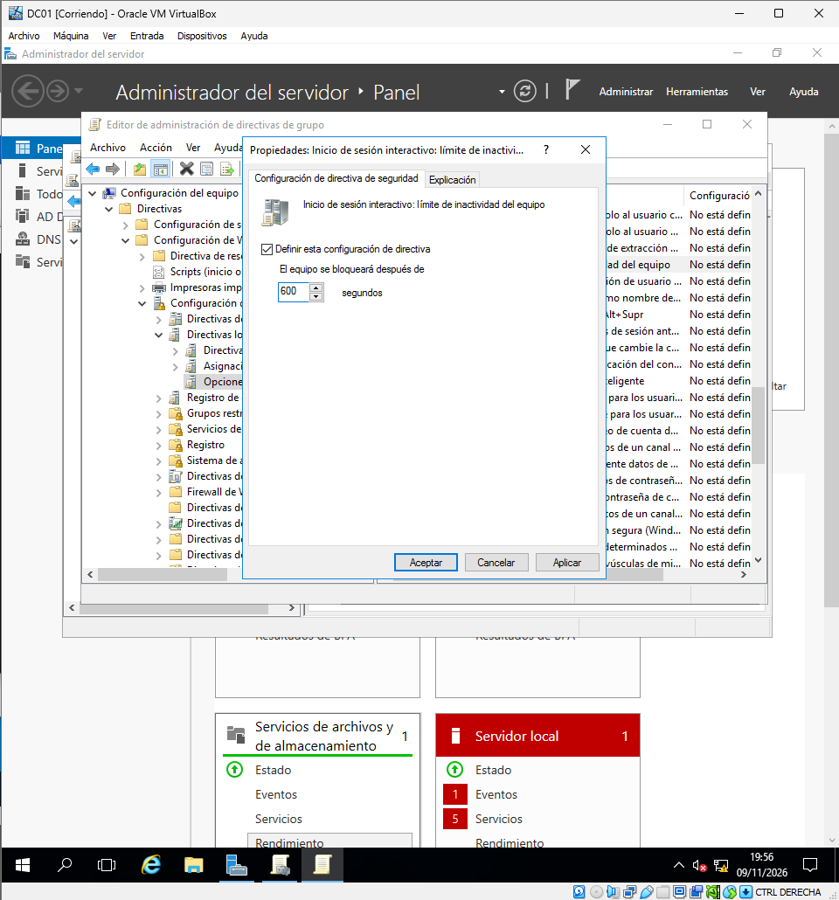
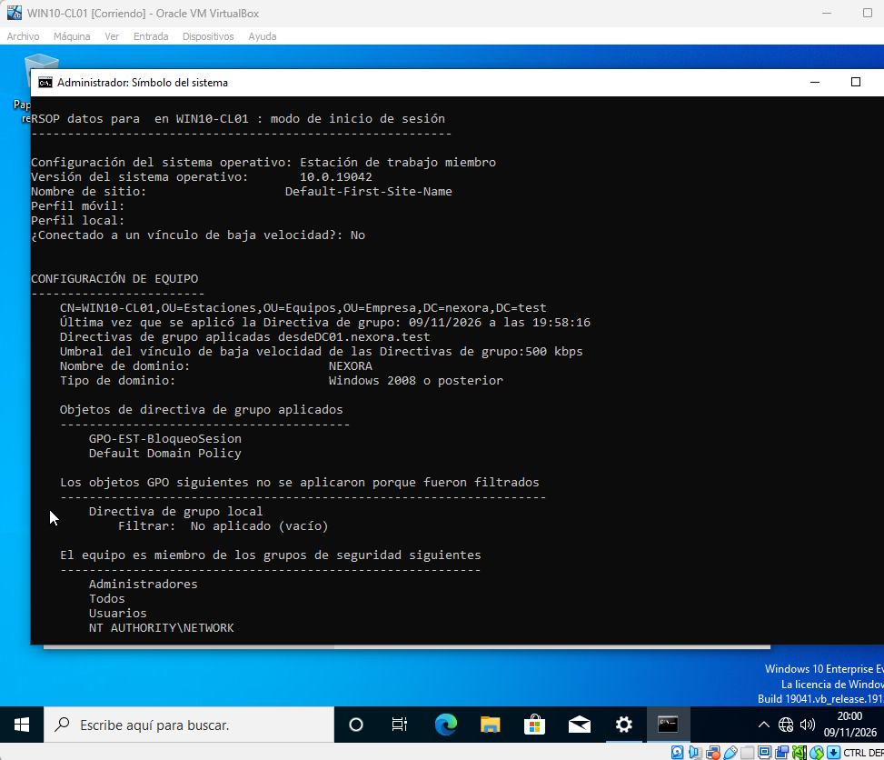
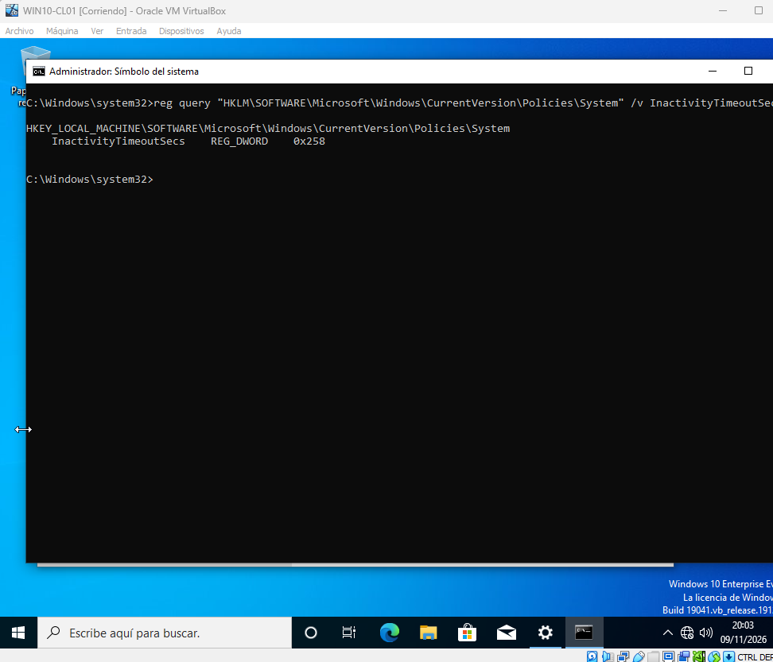
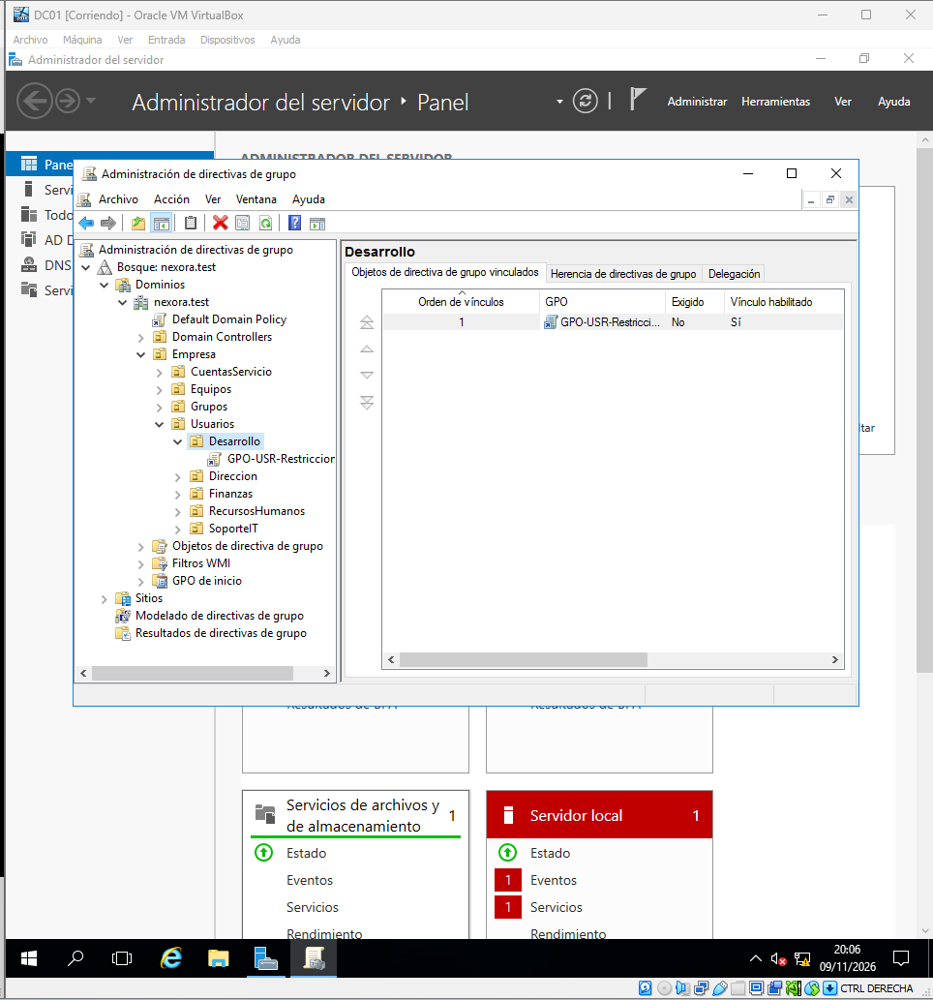
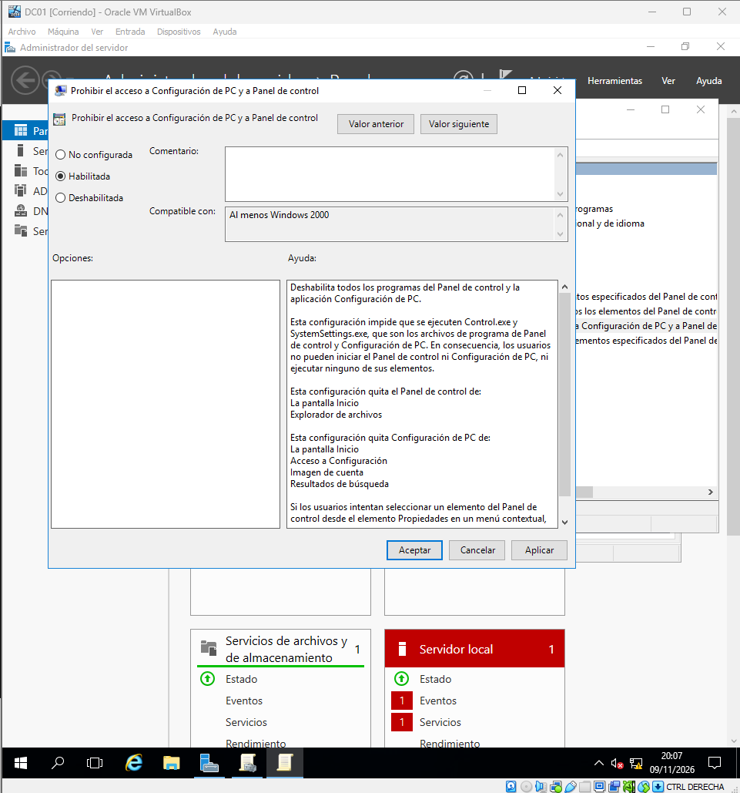
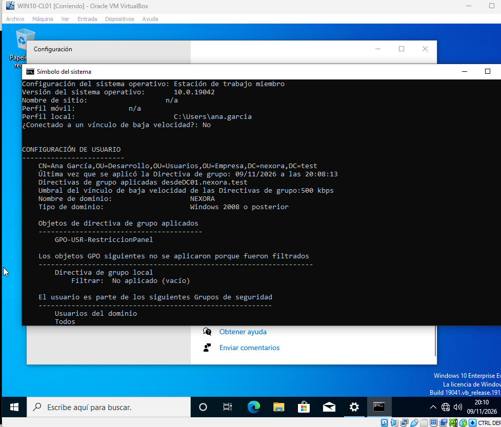
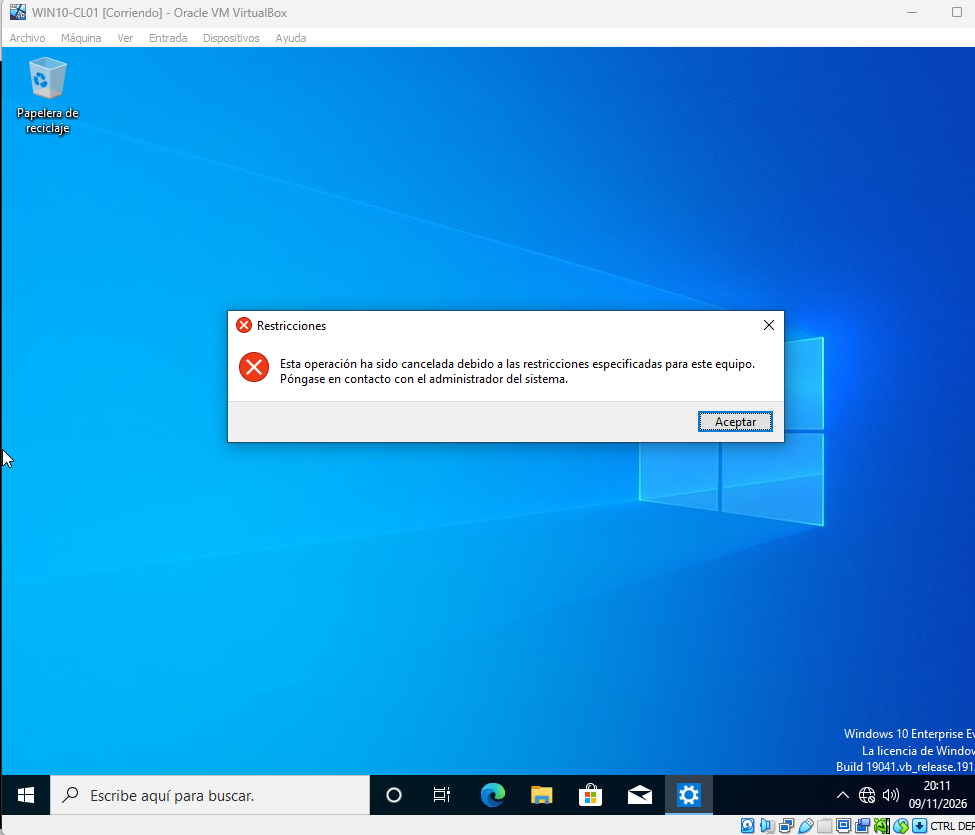

# Fase 07 — Directivas de grupo (GPO)

## Objetivo

Administrar políticas Windows desde Active Directory y demostrar su aplicación tanto a equipos como a usuarios.

## Escenarios registrados

- Política sobre estaciones para bloquear la sesión tras un período de inactividad: la evidencia disponible hace referencia a **600 segundos**.
- Política específica del departamento Desarrollo para restringir el acceso al Panel de control.
- Comprobación de aplicación con `gpresult` y pruebas visibles desde el cliente.

## Comandos de verificación

```powershell
gpupdate /force
gpresult /r
gpresult /h C:\Windows\Temp\resultado-gpo.html
```

`gpresult /r` distingue las directivas aplicadas al usuario y al equipo; conviene verificar el contexto (sesión y OU) antes de atribuir efectos a una GPO concreta.

## Principios de diseño

- Enlazar las políticas a la OU adecuada: equipo vs usuario.
- Mantener separados los escenarios de política de seguridad y restricciones de interfaz.
- Comprobar herencia, filtrado de seguridad y actualización de políticas.
- Documentar valor configurado **y** comportamiento observado.

## Evidencias

Capturas de creación de GPO, configuración de bloqueo a 600 s, prueba aplicada a Windows 10, política de Desarrollo, `gpresult` y restricción del Panel de control. Véase [índice](../evidencias.md).

---

## Guía visual vinculada a las capturas

Esta secuencia relaciona los pasos y decisiones técnicas de la fase con la evidencia obtenida. Las capturas son registros del laboratorio, no instrucciones para copiar configuraciones sin entenderlas.

### 1. GPO para estaciones

Se crea y vincula una política específica para ordenadores.



### 2. Bloqueo a 600 segundos

Se configura una política de bloqueo por inactividad.



### 3. Aplicación de política

Se verifica el procesamiento de la GPO en Windows 10.



### 4. Bloqueo de sesión

Se aporta evidencia del efecto visible de la política.



### 5. GPO para Desarrollo

Se prepara una directiva destinada al departamento técnico.



### 6. Restricción del Panel de control

Se configura la limitación a nivel de usuario.



### 7. Resultado gpresult

Se comprueba qué política recibió la identidad de Desarrollo.



### 8. Prueba de restricción

Se observa el efecto de la directiva en el cliente.


