# Fase 08 — Carpetas compartidas, NTFS y SMB

## Objetivo

Centralizar documentación por departamento en `SRV01` y aplicar permisos de acceso de forma mantenible.

## Modelo AGDLP

**A**ccounts → **G**lobal Groups → **D**omain **L**ocal Groups → **P**ermissions.

Ejemplo de Desarrollo:

1. Usuario en `GG_Desarrollo`.
2. `GG_Desarrollo` se incorpora al grupo local de dominio autorizado sobre el recurso.
3. Los permisos NTFS se asignan al grupo local de dominio, no usuario a usuario.

Esto facilita las altas, bajas y cambios de departamento.

## Comprobaciones

```powershell
# Revisar autorizaciones en una carpeta de prueba (ajustar ruta real):
Get-Acl 'C:\Compartidos\Desarrollo' | Format-List
# Revisar recursos SMB existentes:
Get-SmbShare | Select-Object Name, Path
Get-SmbShareAccess -Name 'Departamentos'
```

**Importante:** la ruta y el nombre del recurso en estos comandos son ejemplos de inspección y deben ajustarse a la configuración efectiva de SRV01.

## Pruebas funcionales

Se documenta acceso permitido y escritura permitida a documentación de Desarrollo, y acceso denegado a Finanzas desde una cuenta no autorizada. Las capturas corresponden a configuración de herencia, NTFS, grupos de permisos y pruebas positivas/negativas.

No basta con que una carpeta sea visible a través de SMB: el acceso efectivo resulta de la combinación de permisos SMB y NTFS. Validar la identidad usada en cada prueba.

---

## Guía práctica ilustrada

Cada paso combina **acción**, **justificación** y **comprobación**. Las capturas se presentan junto a su explicación: las pruebas de mayor valor quedan visibles y los pasos preparatorios pueden desplegarse al pulsar «Ver captura».

## Diseño de carpetas y grupos de autorización

### Paso 1 — Carpetas departamentales

**Qué hicimos.** Creamos carpetas por departamento en el servidor de archivos.

**Por qué.** Una estructura previsible facilita la gestión de la información y la revisión de accesos.

**Cómo lo verificamos.** Identificar carpeta raíz y departamentos configurados.

<details>
<summary>📷 Ver evidencia — Carpetas departamentales</summary>

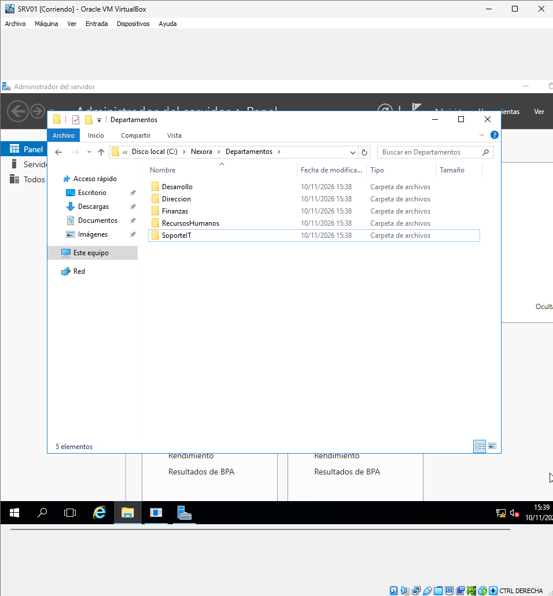

</details>

### Paso 2 — Grupo local de dominio

**Qué hicimos.** Creamos grupos de seguridad locales de dominio para asignar permisos.

**Por qué.** El modelo AGDLP separa el rol del usuario de la autorización sobre un recurso.

**Cómo lo verificamos.** No asignar permisos directamente a usuarios individuales salvo excepciones justificadas.

<details>
<summary>📷 Ver evidencia — Grupo local de dominio</summary>

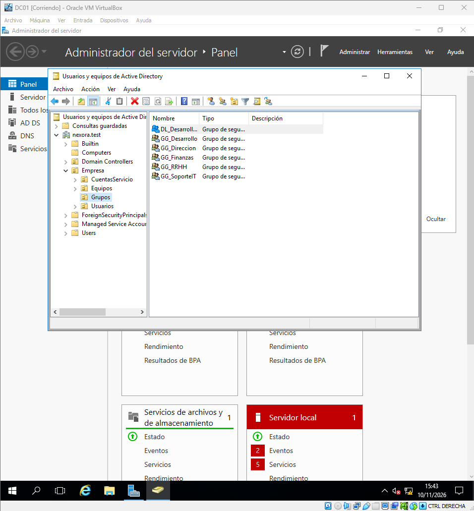

</details>

### Paso 3 — Grupos para permisos

**Qué hicimos.** Creamos grupos de permisos con nombres consistentes.

**Por qué.** La nomenclatura debe permitir reconocer recurso y nivel de acceso.

**Cómo lo verificamos.** Diferenciar permisos de lectura y modificación cuando existan.

<details>
<summary>📷 Ver evidencia — Grupos para permisos</summary>

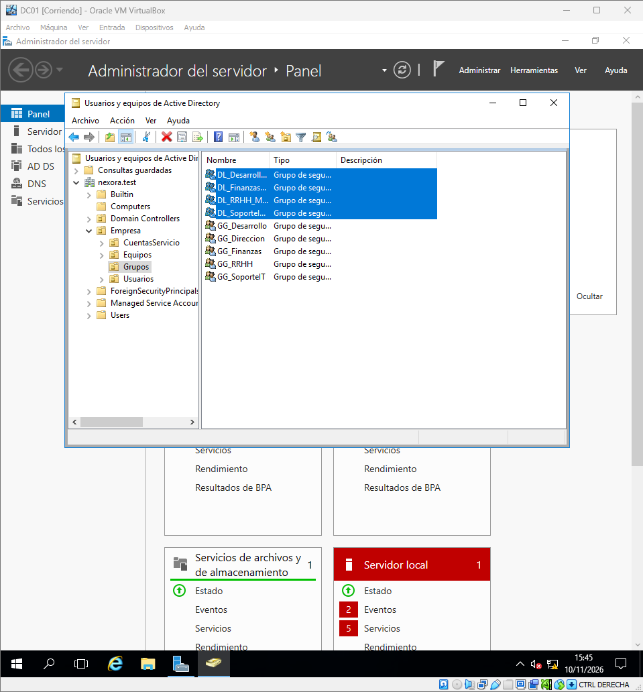

</details>

### Paso 4 — Relación AGDLP

**Qué hicimos.** Introducimos GG_Desarrollo en el grupo local de dominio correspondiente.

**Por qué.** La secuencia cuenta → grupo global → grupo local → permiso facilita altas y traslados.

**Cómo lo verificamos.** Comprobar membresía del grupo local.

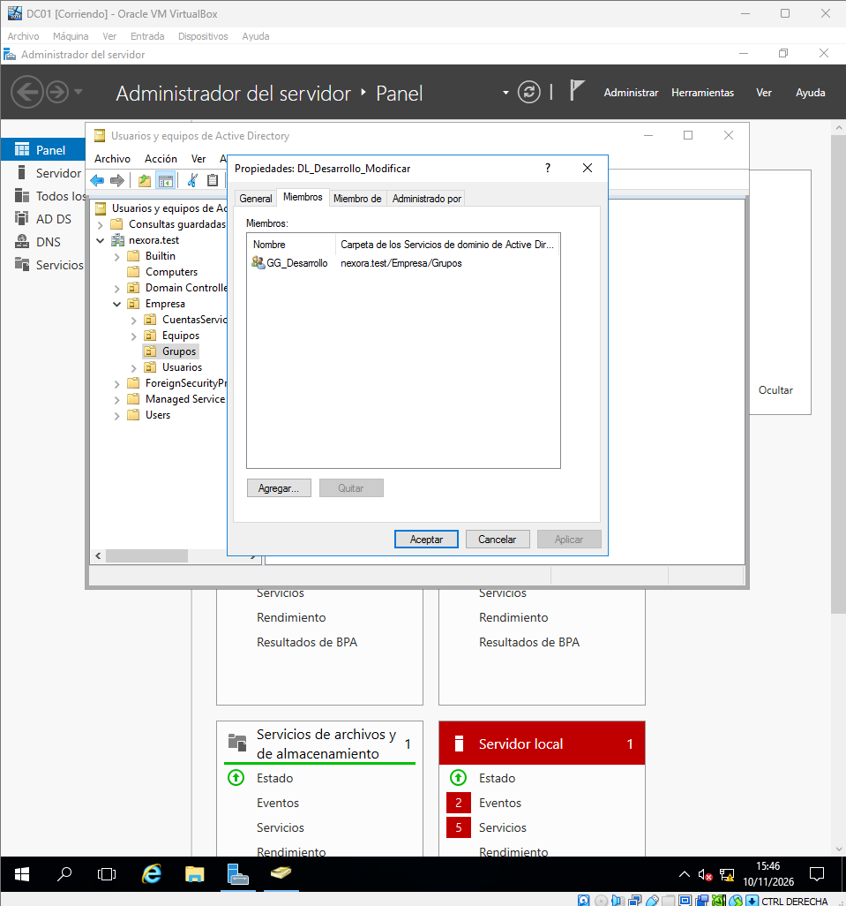

### Paso 5 — Verificación AGDLP

**Qué hicimos.** Verificamos que la relación entre grupos refleja el diseño.

**Por qué.** Las pertenencias erróneas producen accesos excesivos o denegaciones inesperadas.

**Cómo lo verificamos.** Inspeccionar Members y Member Of en ADUC o PowerShell.

<details>
<summary>📷 Ver evidencia — Verificación AGDLP</summary>

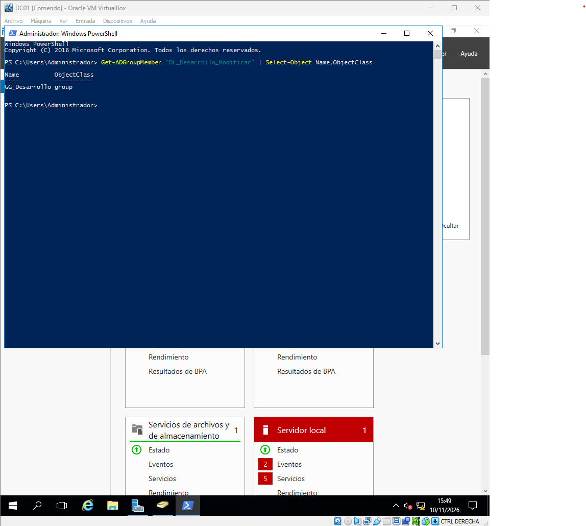

</details>

## Configuración de permisos

### Paso 6 — Herencia NTFS

**Qué hicimos.** Revisamos la herencia de ACL NTFS sobre Desarrollo.

**Por qué.** La herencia puede transmitir permisos no deseados desde el directorio padre.

**Cómo lo verificamos.** Justificar qué entradas se conservan y cuáles se deshabilitan.

<details>
<summary>📷 Ver evidencia — Herencia NTFS</summary>

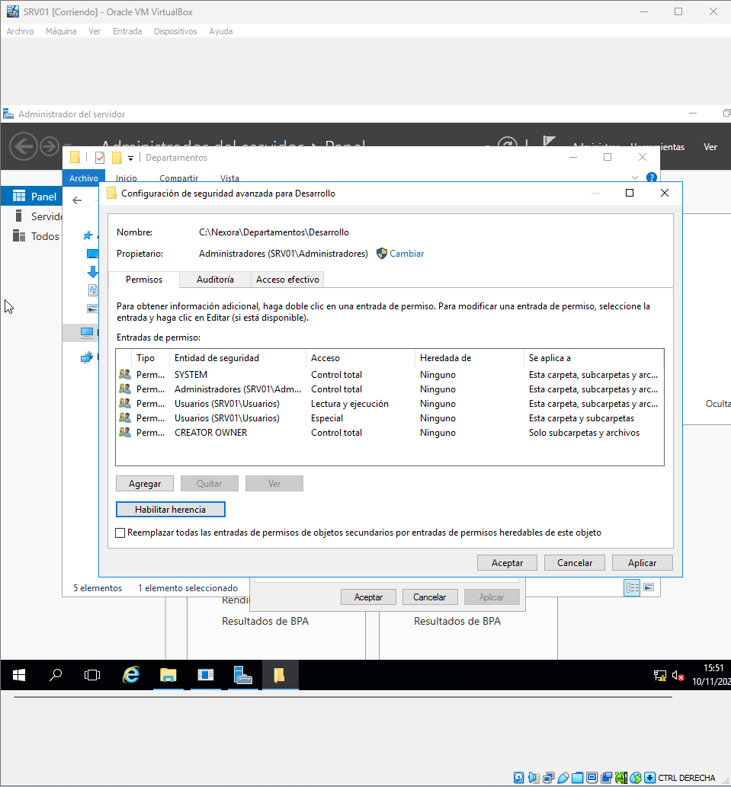

</details>

### Paso 7 — Permisos NTFS

**Qué hicimos.** Configuramos permisos NTFS sobre la carpeta Desarrollo.

**Por qué.** NTFS aplica el control de acceso sobre el sistema de archivos, incluso por acceso local.

**Cómo lo verificamos.** Identificar los grupos y derechos efectivos sin asumir que el nombre del grupo garantiza el permiso.

<details>
<summary>📷 Ver evidencia — Permisos NTFS</summary>

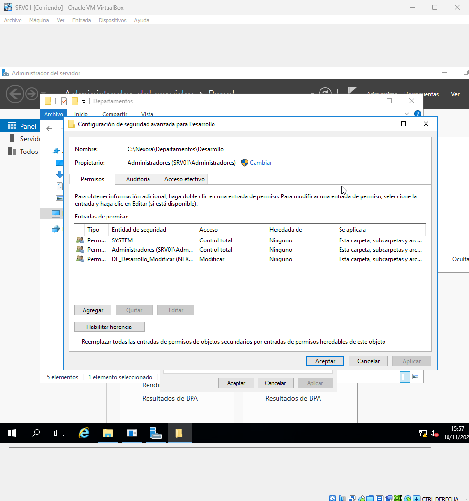

</details>

### Paso 8 — Permisos SMB

**Qué hicimos.** Revisamos los permisos del recurso compartido SMB.

**Por qué.** El acceso remoto está sujeto a permisos SMB y NTFS; prevalece la combinación más restrictiva.

**Cómo lo verificamos.** Comprobar también que no se abre el acceso a Everyone de forma no prevista.

<details>
<summary>📷 Ver evidencia — Permisos SMB</summary>

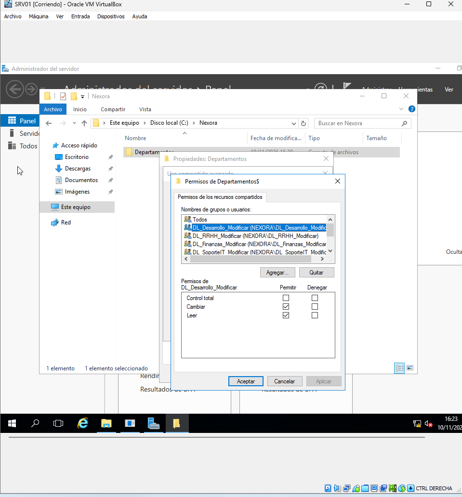

</details>

### Paso 9 — Permisos de la raíz

**Qué hicimos.** Inspeccionamos la ACL de la raíz compartida.

**Por qué.** La raíz debe permitir atravesar la estructura según el diseño sin conceder escritura indiscriminada.

**Cómo lo verificamos.** Validar los permisos mínimos necesarios.

<details>
<summary>📷 Ver evidencia — Permisos de la raíz</summary>

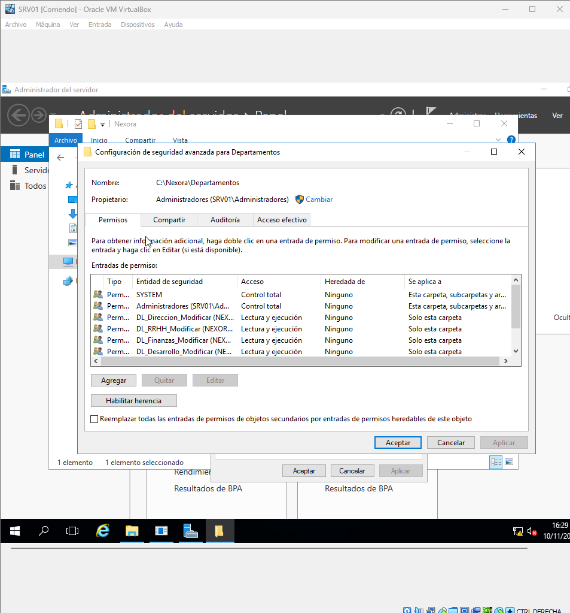

</details>

### Paso 10 — Acceso autorizado

**Qué hicimos.** Comprobamos la entrada al recurso desde un usuario autorizado de Desarrollo.

**Por qué.** El acceso permitido prueba una parte de la matriz, pero no confirma escritura.

**Cómo lo verificamos.** Identificar la cuenta con la que se realiza la prueba.

<details>
<summary>📷 Ver evidencia — Acceso autorizado</summary>

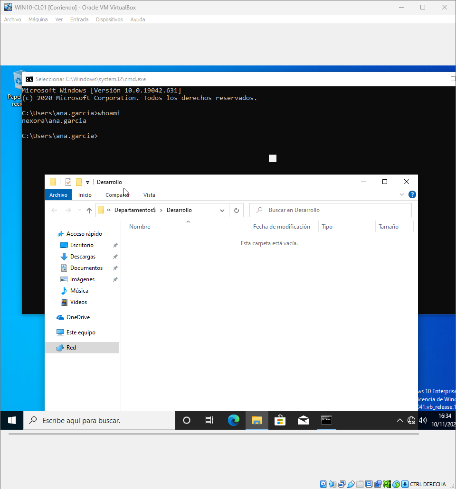

</details>

## Pruebas positivas y negativas

### Paso 11 — Escritura autorizada

**Qué hicimos.** Creamos o modificamos un archivo dentro de Desarrollo con una identidad autorizada.

**Por qué.** La escritura es una prueba distinta de listar y abrir carpetas.

**Cómo lo verificamos.** Verificar que el archivo realmente puede guardarse.

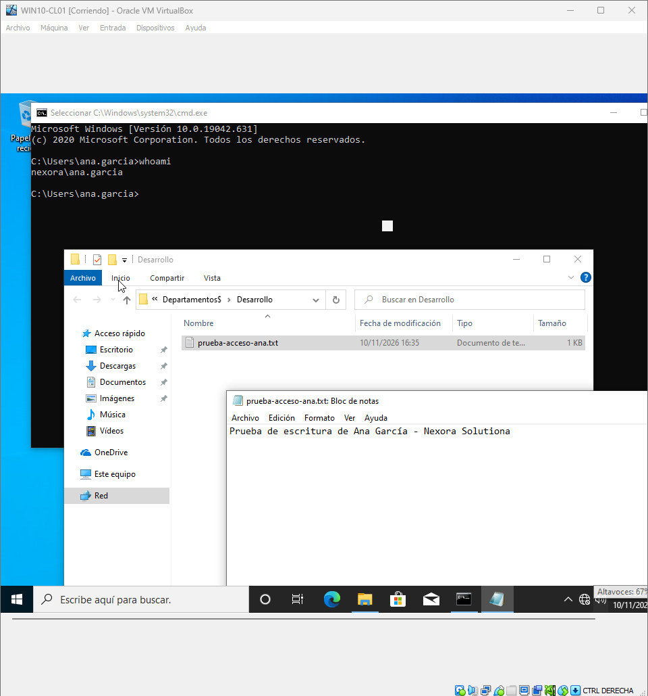

### Paso 12 — Acceso denegado

**Qué hicimos.** Probamos una identidad sin permisos sobre Finanzas y observamos la denegación.

**Por qué.** Los controles de acceso deben superar pruebas negativas, no solo positivas.

**Cómo lo verificamos.** Documentar claramente usuario, recurso solicitado y mensaje de denegación.

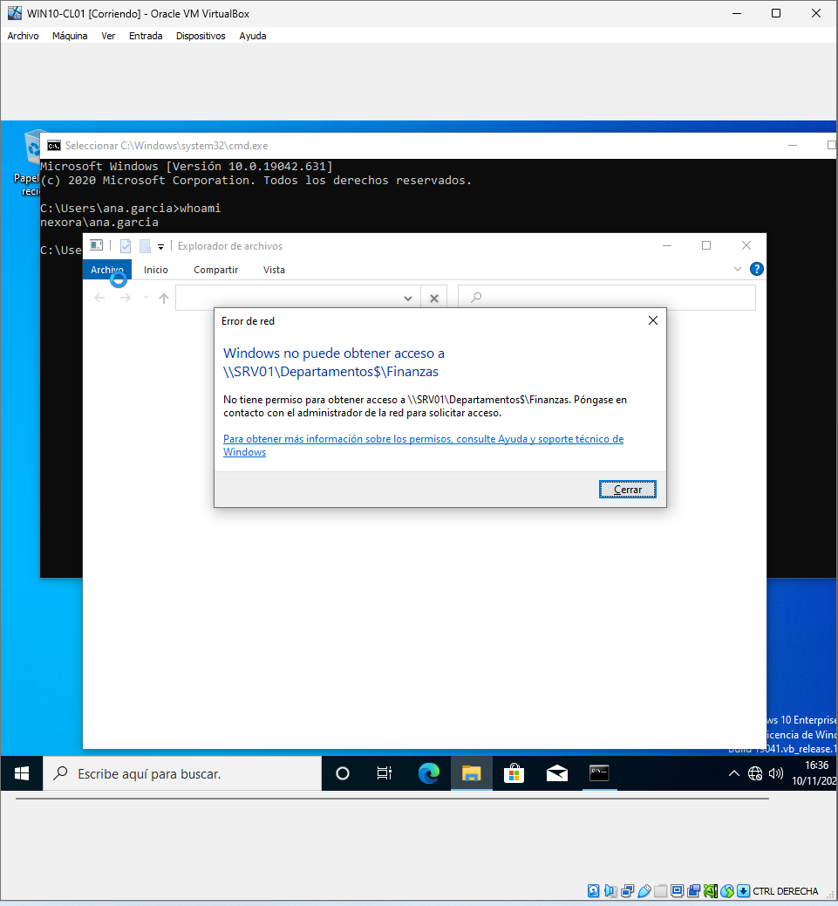

### Paso 13 — Protección de la raíz

**Qué hicimos.** Revisamos la protección del directorio compartido principal.

**Por qué.** Las ACL de la raíz condicionan accesos y herencia del resto de departamentos.

**Cómo lo verificamos.** Comprobar que el endurecimiento no impide el acceso legítimo a recursos hijos.

<details>
<summary>📷 Ver evidencia — Protección de la raíz</summary>

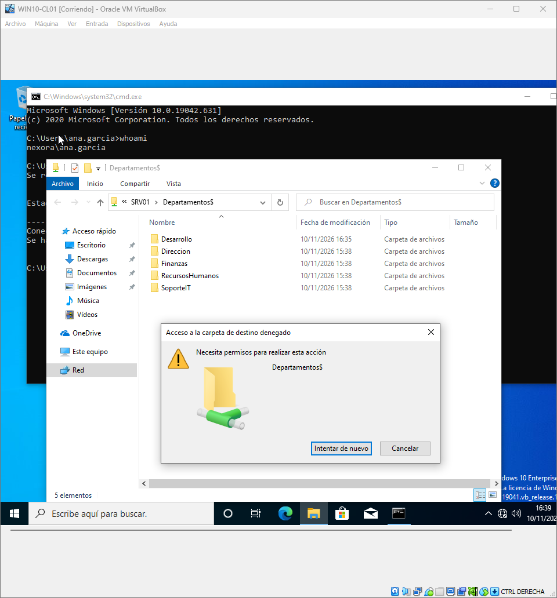

</details>

---

### Resultado y límites de la fase

**Interpretación:** la captura acredita el paso indicado en el entorno de laboratorio. La validez del servicio completo requiere además las verificaciones descritas en esta fase.

[↑ Volver a la portada](../../README.md) · [Consultar el inventario de evidencias](../evidencias.md)
