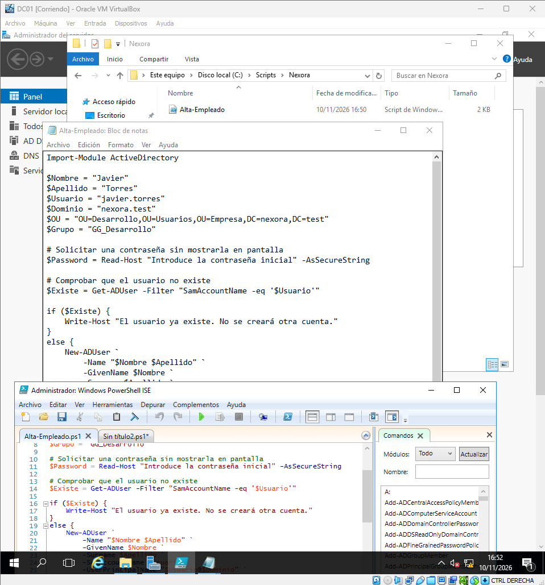
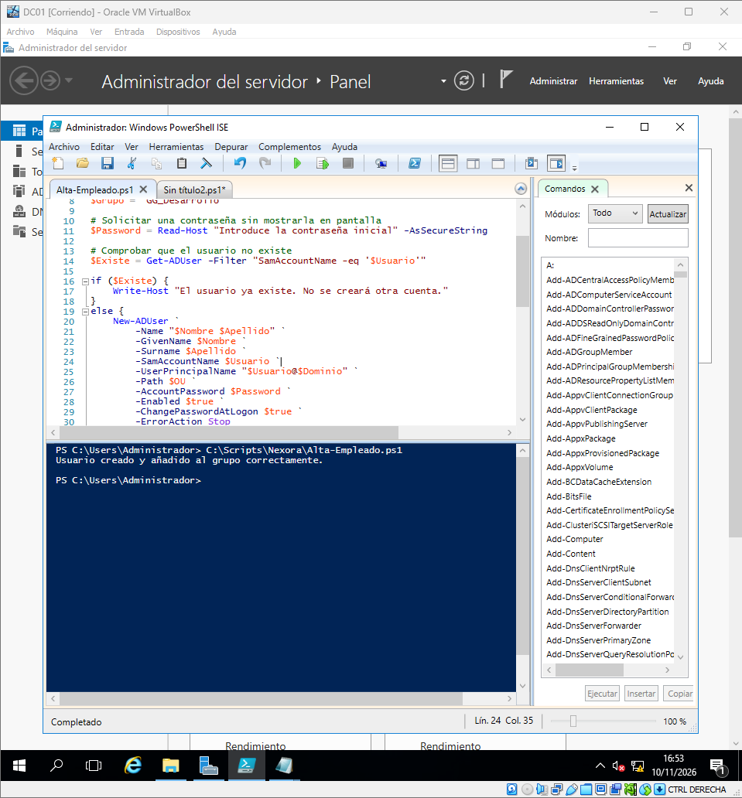
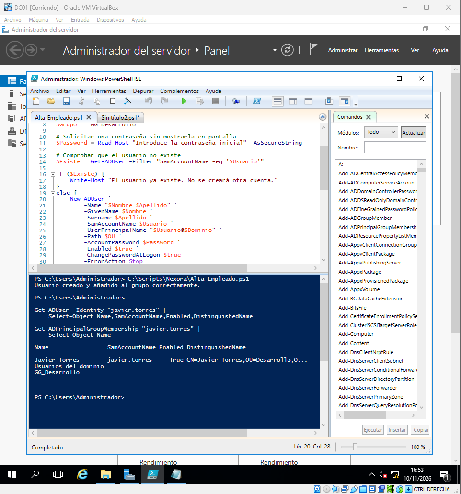
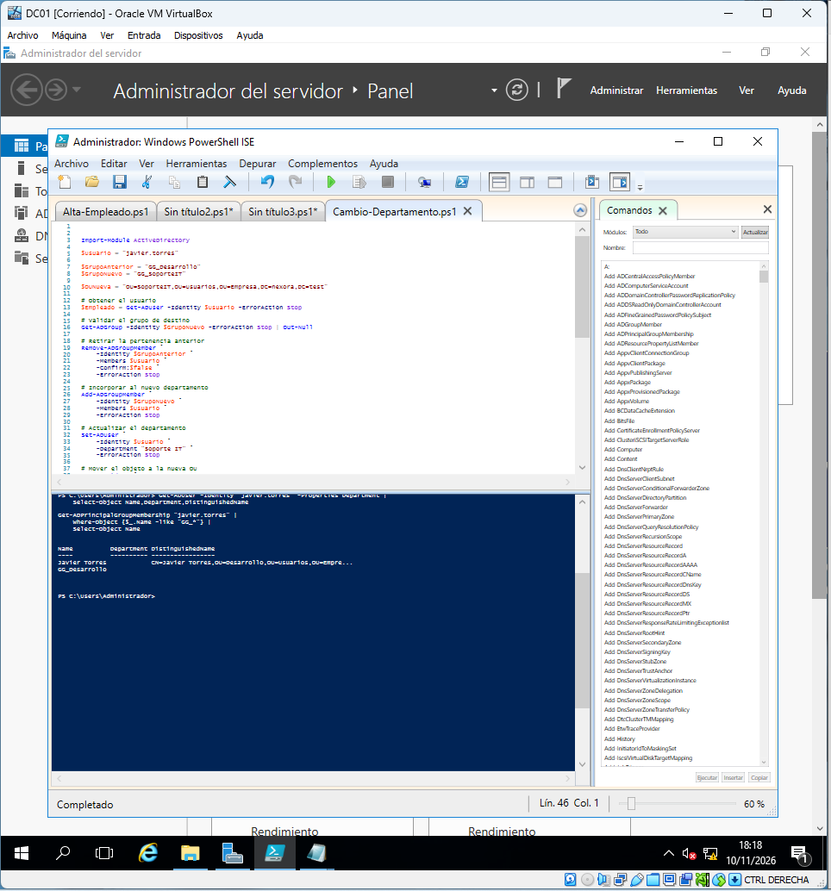
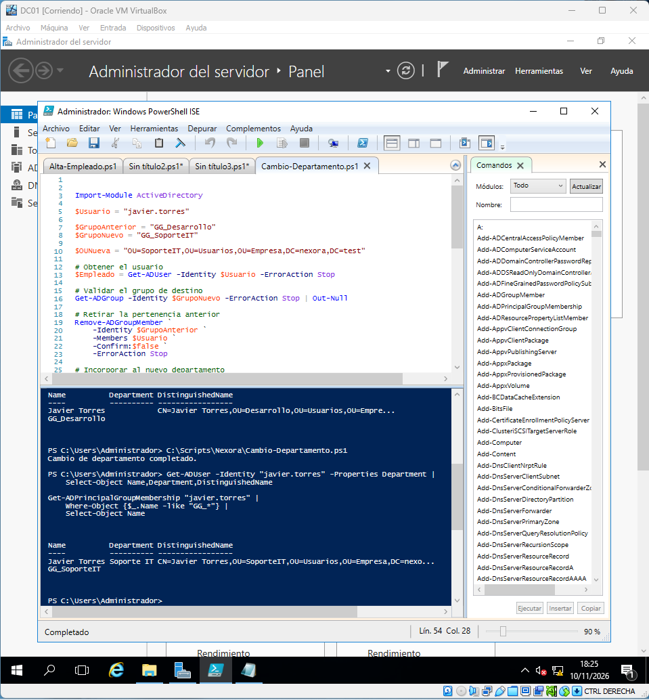
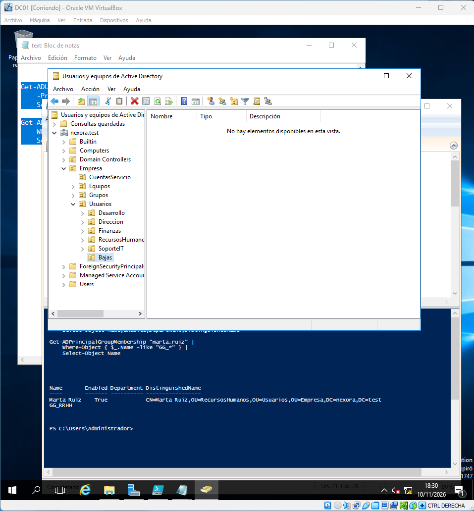
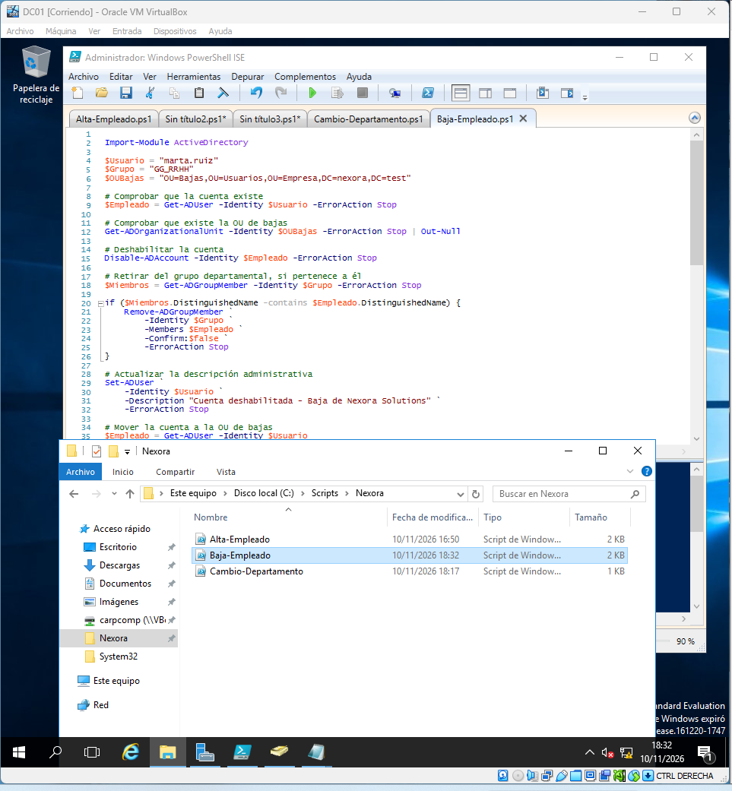
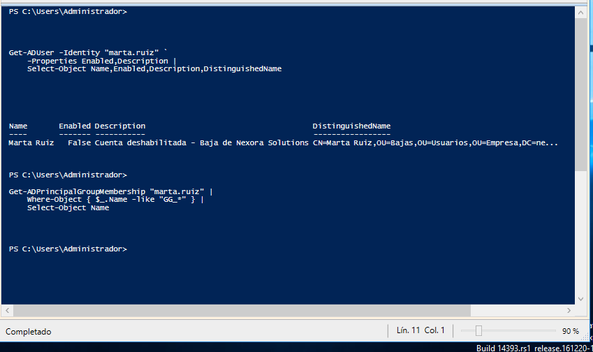

# Fase 09 — Administración con PowerShell

## Objetivo

Simular operaciones habituales del ciclo de vida de empleados y demostrar cómo reducir tareas repetitivas: alta, cambio de departamento y baja lógica.

## Escenarios con evidencias

- Alta de usuario y comprobación posterior.
- Cambio de departamento y revisión de su pertenencia/ubicación.
- Creación de OU de bajas y retirada del acceso.
- Validación de los cambios con PowerShell y ADUC.

## Buenas prácticas

- Scripts parametrizados y ejecución con permisos mínimos.
- `-WhatIf` en operaciones compatibles y comprobaciones previas.
- No almacenar contraseñas en texto plano.
- No borrar cuentas definitivamente en una práctica de bajas: deshabilitar y mover a OU de bajas según política.
- Registrar cada cambio y su resultado.
- Comprobar grupos de origen y destino al mover empleados.

El ZIP contiene **capturas de código y ejecución**, pero no los archivos `.ps1` originales. No se han reconstruido como si fueran scripts ejecutados. La carpeta `scripts/powershell/` contendrá ejemplos auditables separados claramente de los originales.

---

## Guía visual vinculada a las capturas

Esta secuencia relaciona los pasos y decisiones técnicas de la fase con la evidencia obtenida. Las capturas son registros del laboratorio, no instrucciones para copiar configuraciones sin entenderlas.

### 1. Script de alta

Se presenta un procedimiento de incorporación de empleados.

### 2. Ejecución de alta

Se documenta la ejecución del proceso.

### 3. Verificación del alta

Se revisa la cuenta resultante en AD.

### 4. Script de traslado

Se muestra la automatización del cambio de departamento.

### 5. Verificación del traslado

Se consulta el departamento y las pertenencias posteriores.

### 6. OU de bajas

Se prepara la organización de cuentas deshabilitadas.

### 7. Script de baja

Se representa el proceso de retirada de acceso.

### 8. Verificación de baja

Se comprueba el estado final de la cuenta.

