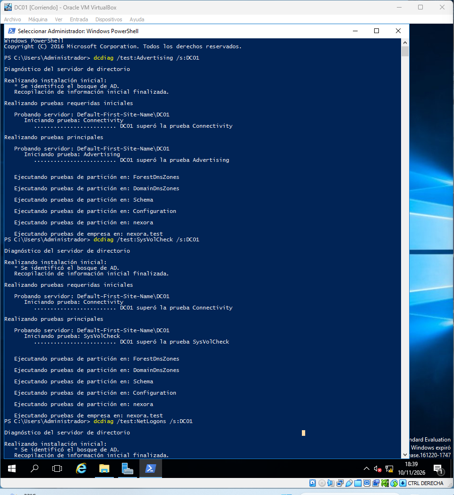
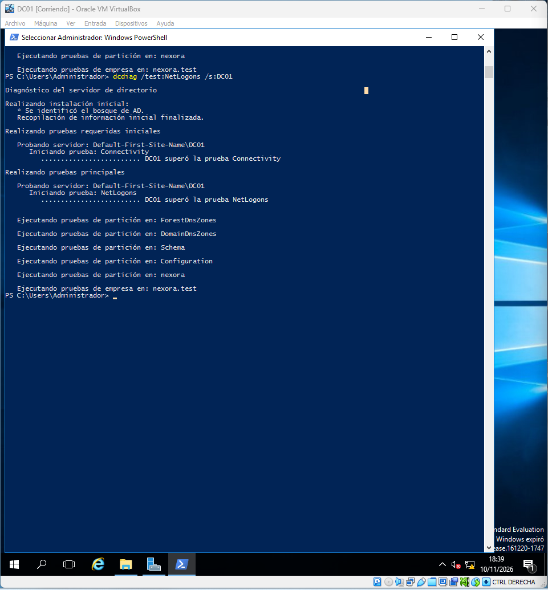
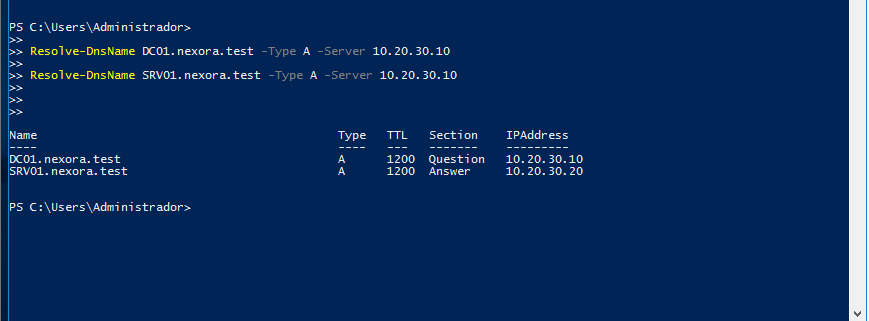
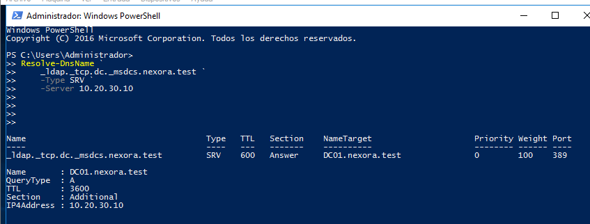
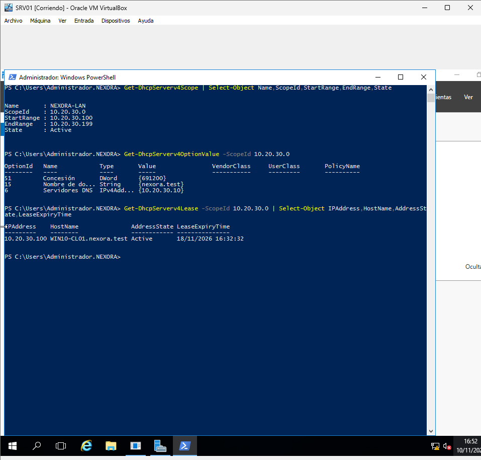
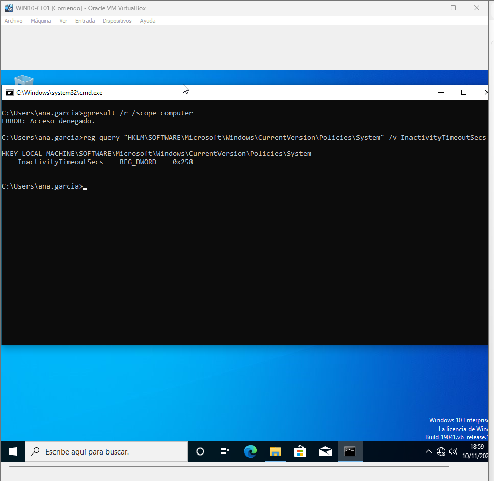
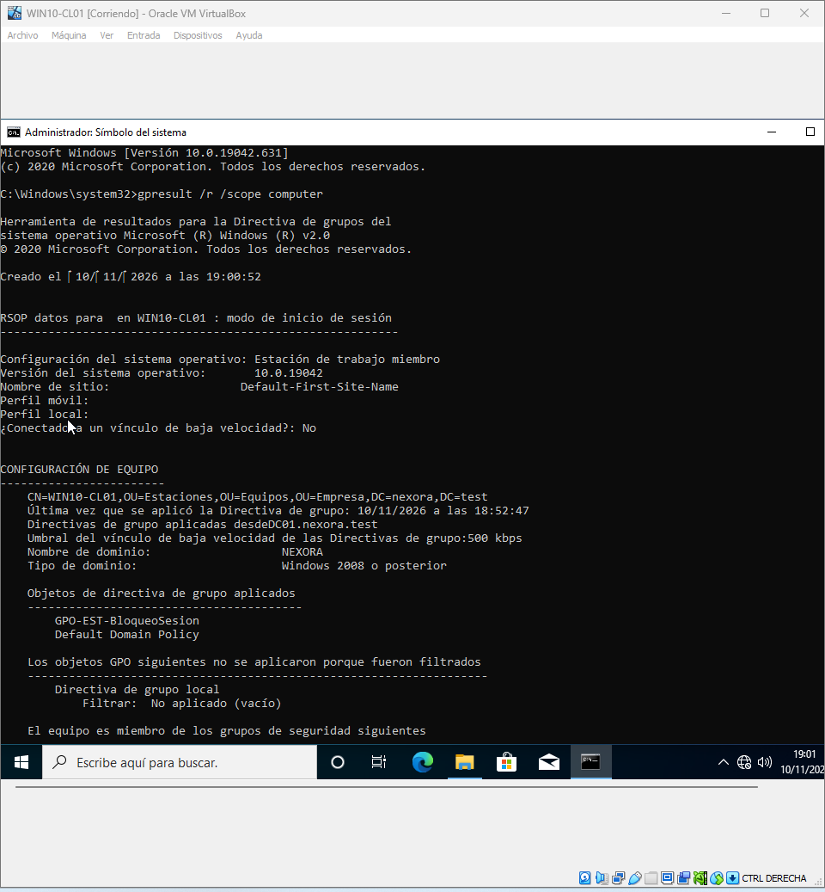
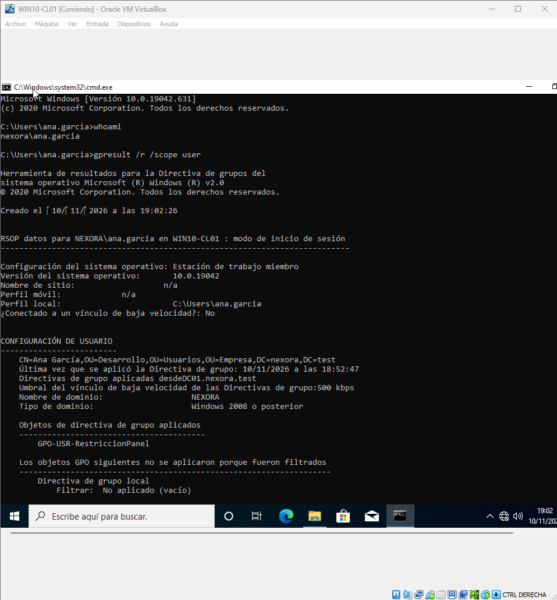
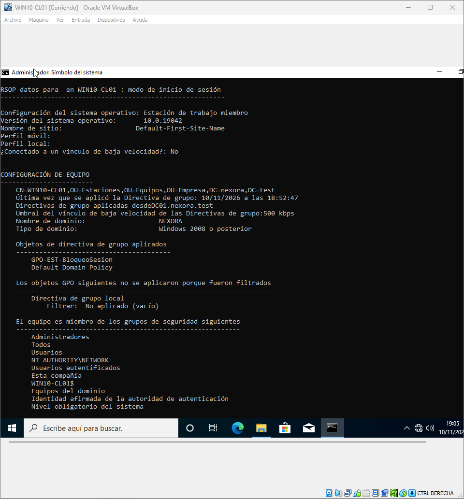

# Fase 10 — Validación del laboratorio

## Objetivo

Confirmar los servicios mediante pruebas reproducibles, con capturas de resultados y anotación de incidencias.

| Área | Verificación recomendada | Evidencias disponibles |
|---|---|---|
| AD DS | `Get-ADDomain`, `dcdiag` | Validación AD (2 capturas) |
| DNS | `Get-DnsServerZone`, `Resolve-DnsName` registro A/SRV | Zonas y registros |
| DHCP | `Get-DhcpServerv4Scope`, cliente `ipconfig /all` | Validación DHCP |
| GPO equipo | `gpresult /r` y bloqueo de sesión | Política 600 s |
| GPO usuario | `gpresult /r` y restricción Panel de control | Política de usuario |
| SMB/NTFS | Acceso permitido y denegado con usuarios distintos | Capturas en fase 08 |

## Criterio de aceptación

Una fase está validada cuando se registra **configuración + comando o procedimiento de prueba + resultado esperado + resultado observado**. La presencia de las imágenes no reemplaza la descripción de los comandos ni la revisión del resultado real.

## Limitaciones

- El proyecto es un laboratorio educativo aislado.
- No se ha implementado alta disponibilidad ni redundancia de controladores de dominio.
- Los sistemas operativos pertenecen a generaciones anteriores y no deben presentarse como arquitectura recomendada de producción.

---

## Guía visual vinculada a las capturas

Esta secuencia relaciona los pasos y decisiones técnicas de la fase con la evidencia obtenida. Las capturas son registros del laboratorio, no instrucciones para copiar configuraciones sin entenderlas.

### 1. Validación de AD DS

Se comprueban componentes fundamentales del controlador de dominio.

### 2. Validación de AD DS

Se comprueban componentes fundamentales del controlador de dominio.

### 3. Registro A

Se prueba la resolución del nombre del servidor.

### 4. Zonas y SRV

Se comprueba la resolución de registros usados por AD DS.

### 5. Validación de DHCP

Se inspecciona el servicio y el ámbito DHCP.

### 6. Validación de bloqueo

Se comprueba la política de inactividad.

### 7. Resultado de políticas de equipo

Se inspecciona la aplicación de GPO al equipo.

### 8. Resultado de políticas de usuario

Se inspecciona la aplicación de GPO al usuario.

### 9. Validación final de GPO

Se completa la comprobación de política de equipo.

