# Incidencia 002 — Zonas DNS ausentes después de promover DC01

## Síntoma

Tras promover `DC01` a controlador de dominio de `ad.nexora.example`, las consultas SRV fallaban y `Get-DnsServerZone` no mostraba las zonas del dominio. La creación gráfica y por PowerShell devolvía un error de nombre inválido o `WIN32 123`.

## Diagnóstico documentado

- `Get-ADDomain` devolvía el dominio, y los servicios `DNS`, `NTDS` y `Netlogon` estaban iniciados.
- `net share` mostraba `SYSVOL` y `NETLOGON`.
- Se registró el evento DNS 4013, asociado a la espera de sincronización inicial del directorio.
- Las particiones `DomainDnsZones` y `ForestDnsZones` existían, pero no se localizaron las zonas esperadas.
- Se crearon correctamente zonas temporales de prueba, tanto en archivo local como integradas en AD; la zona real falló en ambas modalidades.
- `dnscmd /zoneinfo` confirmó que la zona real no existía en el servicio DNS.

## Recuperación

Se restauró una instantánea previa a la promoción y se creó el dominio `nexora.test`. Las zonas `nexora.test` y `_msdcs.nexora.test` aparecieron integradas en AD. Una consulta SRV devolvió `DC01.nexora.test`.

## Aprendizaje y limitación

La recuperación resolvió el problema operativo. **No se demostró la causa raíz exacta** del error 123 ni puede atribuirse con seguridad al sufijo `.example`. En futuros despliegues, registrar los errores de promoción y revisar eventos de AD DS y DNS antes de repetir cambios.

## Evidencias visuales de la incidencia

### 1. comprobacion puertos adds

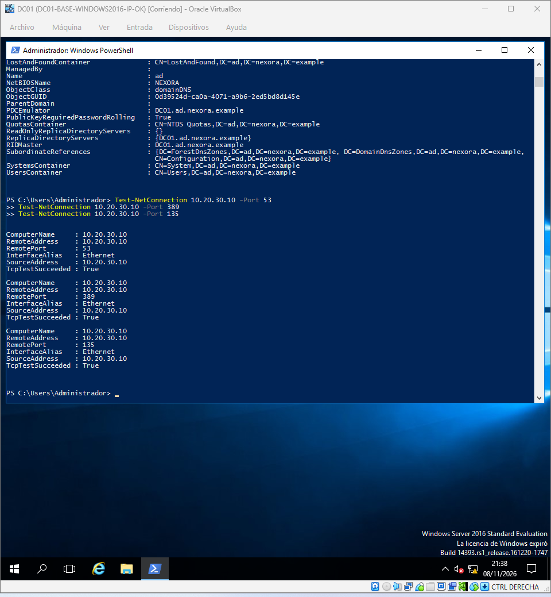

### 2. eventos servicio dns

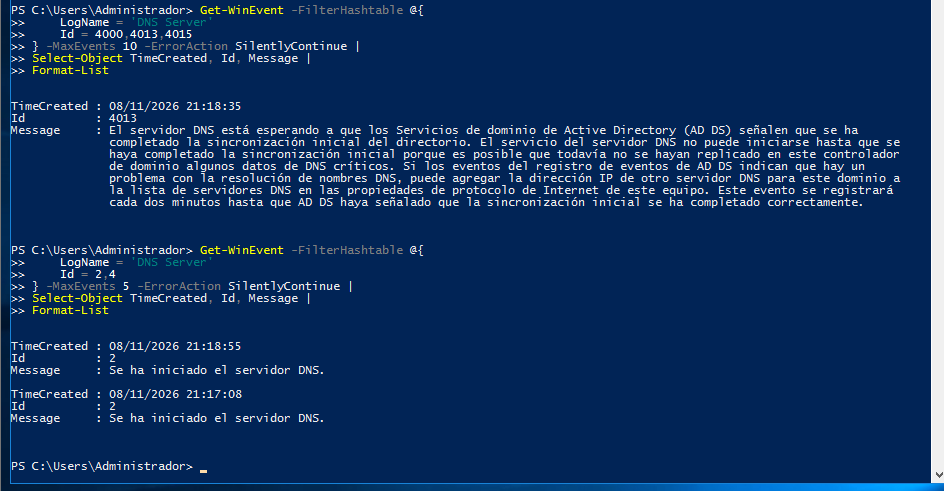

### 3. sincronizacion adds dns

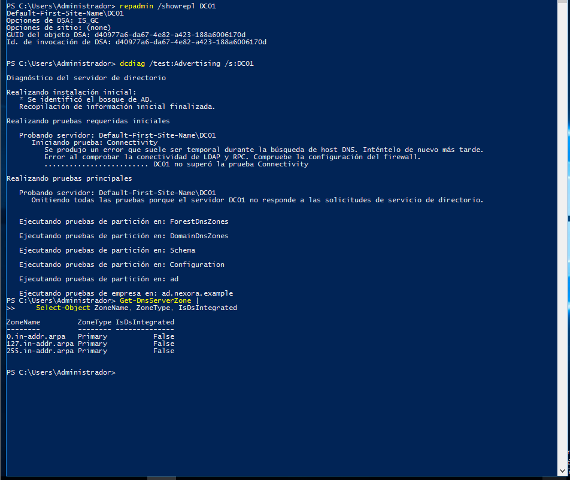

### 4. particiones ad sysvol

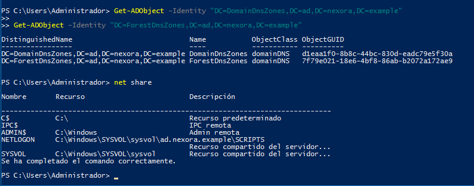

### 5. zonas dns active directory

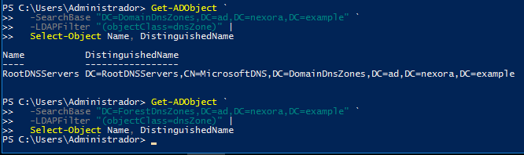

### 6. administrador dns

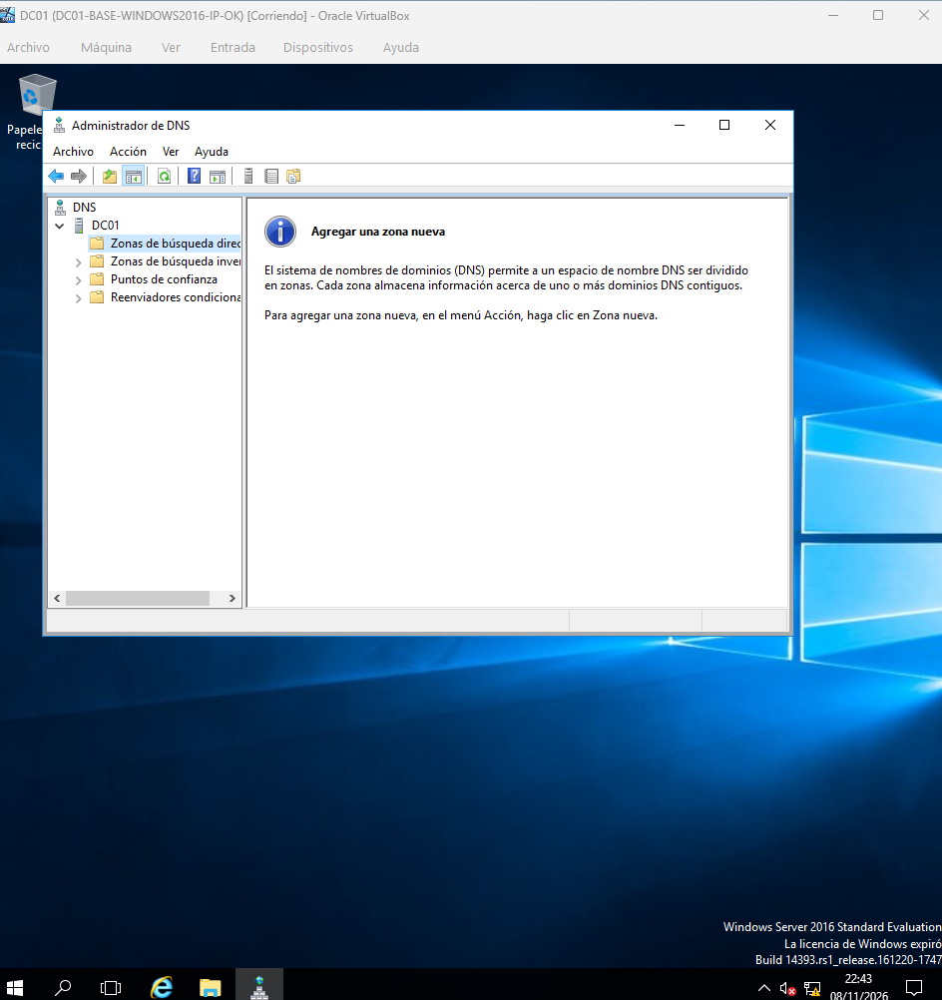

### 7. error creacion zona dns

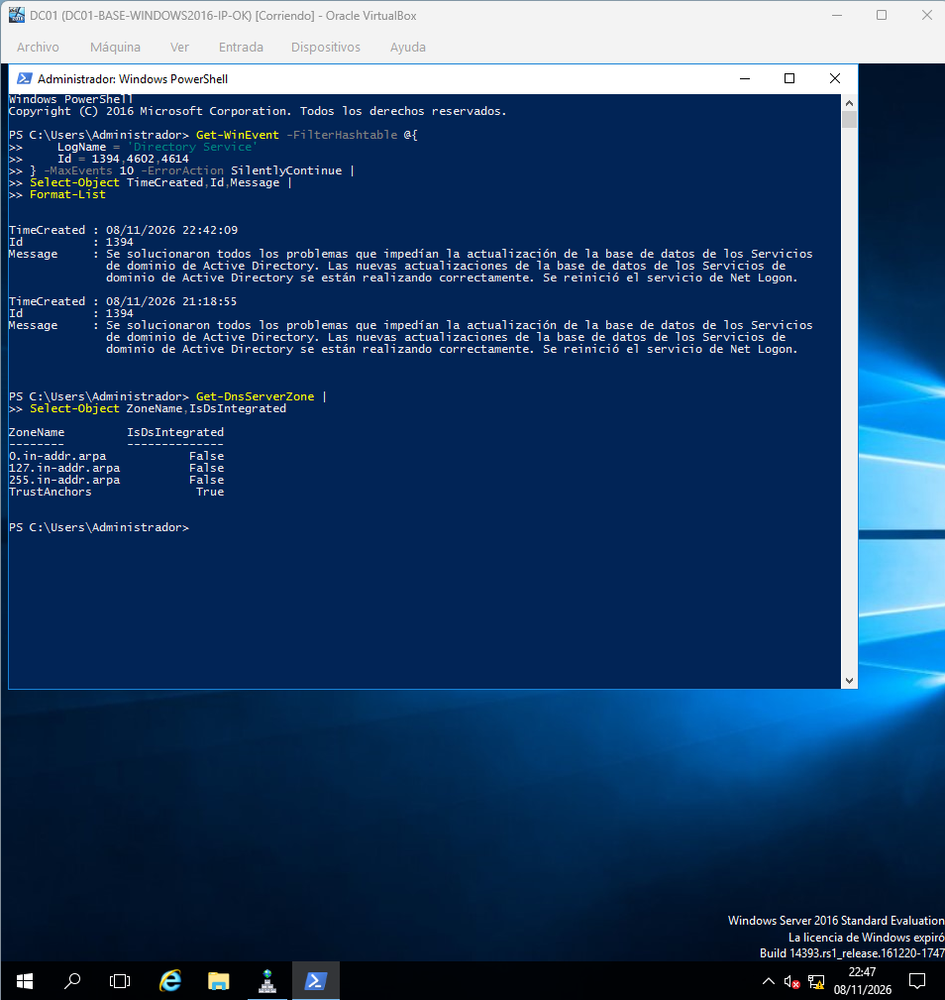

### 8. particiones dns

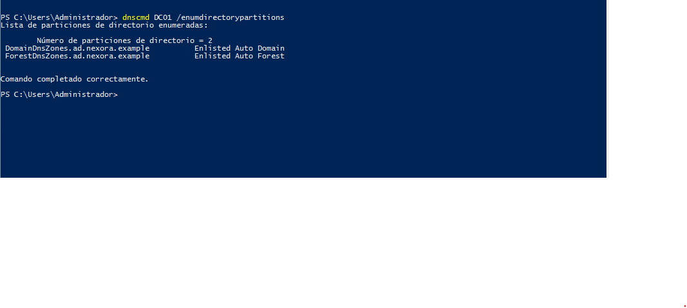

### 9. fsmo replicacion

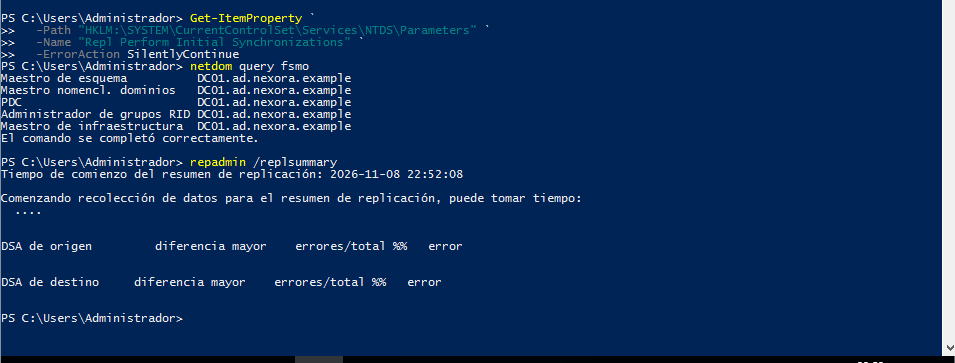

### 10. prueba zona dns temporal

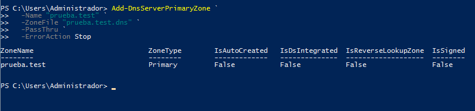

### 11. prueba integracion dns ad

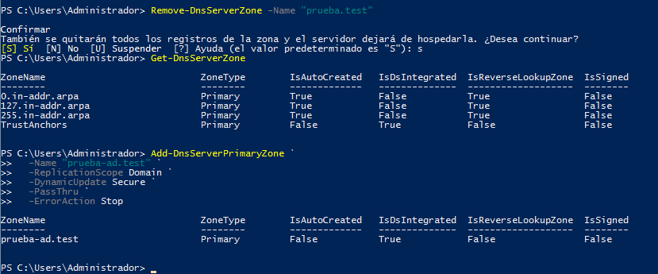

### 12. prueba zona dominio local

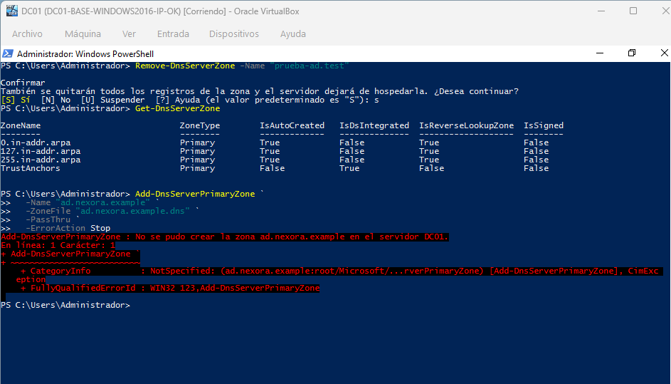

### 13. diagnostico configuracion zona

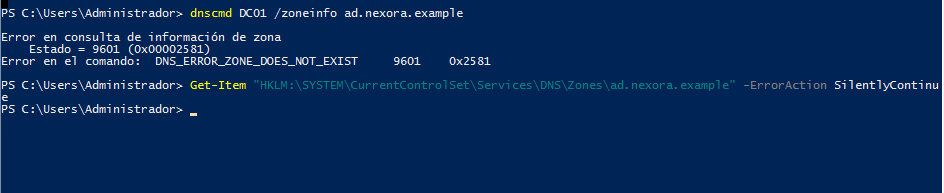
