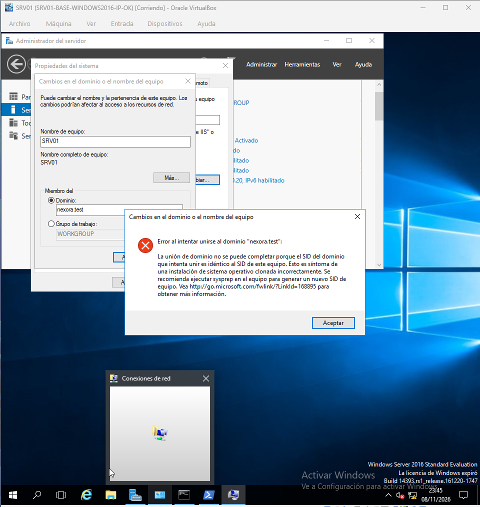

# Incidencia 003 — SID durante la incorporación de SRV01

El archivo de evidencias incluye una captura denominada `05-05-error-sid-srv01.png`, seguida de capturas de unión al dominio y validación del canal seguro.

**Estado documental:** el fallo y el resultado posterior están indicados por las evidencias, pero no se dispone aquí de una transcripción completa del mensaje ni de las acciones de recuperación. No se atribuye una causa raíz sin confirmación.

## Validación reproducible

```powershell
Test-ComputerSecureChannel
```

Para completar esta incidencia: transcribir el error observado, detallar acciones reales realizadas y comprobar `True` en el resultado, junto con la ubicación de SRV01 en AD.

## Evidencias visuales de la incidencia

### 1. error sid srv01


